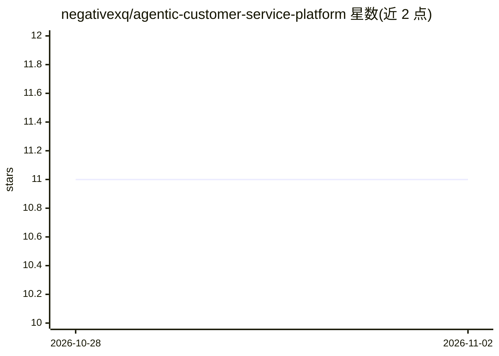

# negativexq/agentic-customer-service-platform

⭐ 11 · Python · MIT · 推送 2026-10-28 · [GitHub](https://github.com/negativexq/agentic-customer-service-platform) · [官网](https://omerfkoc.dev) · 个人维护

**生产导向的客服 AI agent 控制平面：LLM 提议、确定性软件裁决执行**

面向客服运营的参考实现平台：回答政策/FAQ 问题（混合检索+溯源校验），并执行订单查询、退款、取消、建单、人工升级等受控操作。核心机制是权限边界：LLM 只产出语义提议，认证、目标解析、策略、确认、幂等与执行由服务端确定性代码持有，RAG 证据不授予变更权限。技术栈为 LangGraph+PostgreSQL 检查点、FastAPI、Qdrant 混合检索、React 操作台、OpenTelemetry/Jaeger 可观测性，通过 Docker Compose 本地运行。声明的评估证据为参考部署级别，非无限制生产认证。

## 筛选速览

| 维度 | 判定 | 备注 |
|---|---|---|
| AI 角色 | `ai-ecosystem` | LLM/agent 周边工具 |
| 许可风险 | `permissive` | MIT |
| 部署形态 | `self-host` | docker 或自建部署 |
| 模型依赖 | — | README 未给出锁定关系 |
| 硬件要求 | — | 无带数字的原话,不猜 |
| 安装摩擦 | `low` | 无编译、无系统依赖或容器化 |
| 成熟度 | — | 结构信号不足 |

## 能力要点

- LLM 语义提议与确定性执行权限分离（编译、策略、确认、再校验、幂等）
- 混合 dense/BM25 检索与溯源校验，证据不足时拒答
- 跨重启的工作流挂起/恢复与幂等写入防重复业务效果
- 只读操作台串联 Request→Evidence→Outcome 全链路审计

## 适用场景

- 搭建带受控退款/取消操作的客服 agent 系统
- 研究 LLM 不直接持有工具调用权限的架构模式
- 为客服工作流引入确认边界、再校验与操作员审计

## 场景标签

`Agent 框架` `RAG` `聊天机器人` · 领域:Agent 开发

## 证据(README 行号)

> L7: Unlike a typical tool-calling chatbot, the LLM never receives direct mutation authority. It produces a semantic prop
> L202: |Agent orchestration|LangGraph + PostgreSQL checkpoints|
> L220: Open <http://localhost:5173>. Setup applies migrations, seeds records, and loads the bundled knowledge base; stop 

## 星数曲线

2026-10-28 11 → 2026-11-02 11（+0）

---
*卡片 v1 · prompt 1.4 · 生成 2026-11-01 · 置信度 mid · 依据 README sha `c53e99c6efe4` · [字段定义](../../DATASET.md)*
