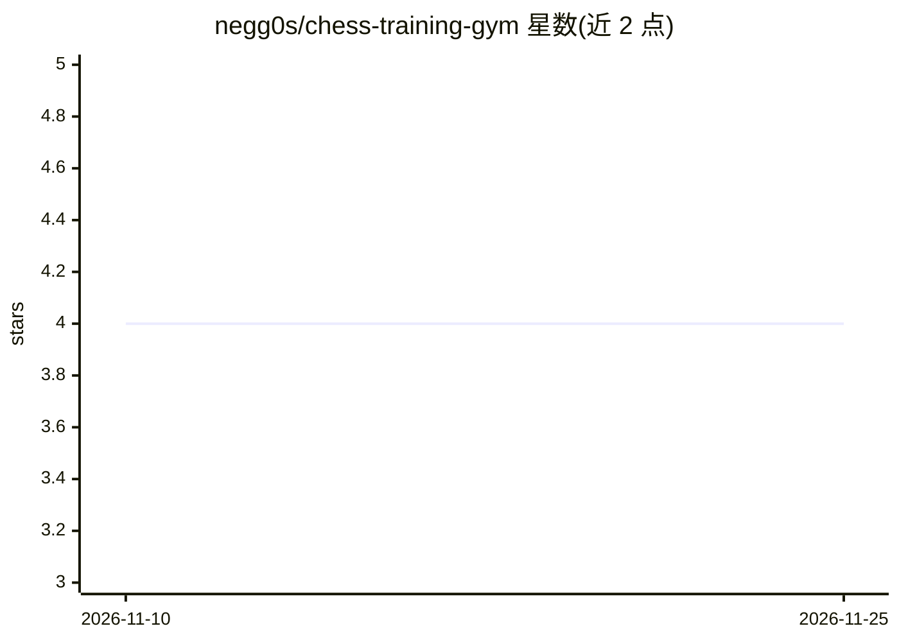

# negg0s/chess-training-gym

⭐ 4 · Python · MIT · 推送 2026-11-21 · [GitHub](https://github.com/negg0s/chess-training-gym) · 个人维护

**为国际象棋神经网络模型准备数据并评估预测的工具包**

面向已有棋局记录和自己模型的用户：将 JSONL 棋局转换为 (13,8,8) 编码张量与下一步走子标签，按整局为单位划分 train/val/test 防止同局泄漏，再对用户模型输出的预测文件计算 top-1/top-k 走子准确率与价值相关性。提供 stats/prepare/eval/report/split/encode/generate 七个 CLI 命令与 Python API。明确不做引擎、不训练模型、不支持 PGN 与 UCI 通信，数据全部读入内存。

## 筛选速览

| 维度 | 判定 | 备注 |
|---|---|---|
| AI 角色 | `ai-ecosystem` | LLM/agent 周边工具 |
| 许可风险 | `permissive` | MIT |
| 部署形态 | `library` | 以包/库形式分发 |
| 模型依赖 | — | README 未给出锁定关系 |
| 硬件要求 | — | 无带数字的原话,不猜 |
| 安装摩擦 | `low` | 无编译、无系统依赖或容器化 |
| 成熟度 | — | 结构信号不足 |

## 能力要点

- FEN 编码为 (13,8,8) 张量，保留原 FEN 与稳定 sample_id
- 按整局划分数据集，防止同一局面的跨 split 泄漏
- 评估 top-1/top-k 走子准确率与价值相关性，支持 sample_id 或 FEN 匹配
- 完整示例流程无需 NumPy 或 PyTorch 即可运行

## 适用场景

- 把已收集的棋局记录转成可用于训练的编码样本
- 在留出测试集上评估自己模型的走子预测
- 按整局划分数据集以避免数据泄漏

## 场景标签

`模型评测` · 领域:评测与运维

## 证据(README 行号)

> L3: Chess Training Gym is a small data-preparation and evaluation toolkit for
> L9: It is not a chess engine and it does not train a neural network. Bring your
> L131: - This project prepares data and scores predictions. It does not train or

## 星数曲线

2026-11-10 4 → 2026-11-25 4（+0）

---
*卡片 v1 · prompt 1.4 · 生成 2026-11-21 · 置信度 high · 依据 README sha `f804bc37a781` · [字段定义](../../DATASET.md)*
