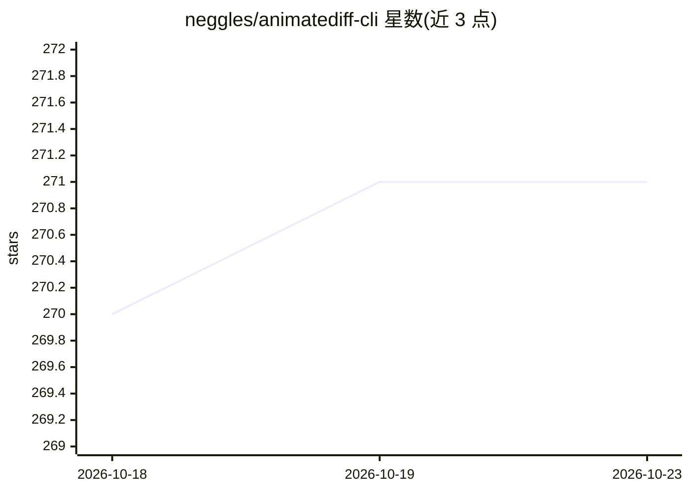

# neggles/animatediff-cli

⭐ 271 · Python · Apache-2.0 · 推送 2026-10-19 · [GitHub](https://github.com/neggles/animatediff-cli) · 个人维护

**AnimateDiff 视频/动画生成的命令行工具，降低显存占用**

基于 guoyww/AnimateDiff 的命令行与 Python 库封装，用 Stable Diffusion 检查点生成动画，主打较低显存占用与无限生成长度（6-8GB 显卡可在 512x512 以 8 帧上下文实现）。使用方式为克隆仓库建 venv 后安装，将检查点放入 data/models/sd、编辑 JSON 提示词配置后执行 animatediff generate。支持批量生成 --repeat、clip_skip、torch.compile 实验支持、RiFE 插帧并导出 WebM/MP4/GIF 等格式（需系统 ffmpeg 与 rife-ncnn-vulkan）。LoRA 加载未实现，img2img 与 webUI 在 TODO 中。

## 筛选速览

| 维度 | 判定 | 备注 |
|---|---|---|
| AI 角色 | `ai-native` | 本体是模型或模型工具 |
| 许可风险 | `permissive` | Apache-2.0 |
| 部署形态 | `desktop` | 安装包/桌面程序 |
| 模型依赖 | — | README 未给出锁定关系 |
| 硬件要求 | `gpu-8g` | |
| 安装摩擦 | `medium` | 含编译或系统依赖之一 |
| 成熟度 | `idea` | |

## 能力要点

- 无限生成长度，6-8GB 显卡可 512x512 生成
- 基于 PyTorch 2.0 SDP Attention，xformers 可选
- RiFE 插帧实验支持，导出 WebM/MP4/GIF 等
- --repeat 批量生成、可从 Python 程序调用且不重复加载模型

## 适用场景

- 用本地 Stable Diffusion 检查点生成动画/短视频
- 低显存（8GB 级）显卡上进行长动画生成
- 生成后用 RiFE 插帧提升帧率并导出视频

## 场景标签

`视频生成` · 领域:内容生成

## 证据(README 行号)

> L1: # animatediff
> L34: animatediff generate -c 'config/prompts/waifu.json' -W 576 -H 576 -L 128 -C 16

## 星数曲线

2026-10-18 270 → 2026-10-23 271（+1）

---
*卡片 v1 · prompt 1.4 · 生成 2026-10-22 · 置信度 mid · 依据 README sha `695edef3afa9` · [字段定义](../../DATASET.md)*
