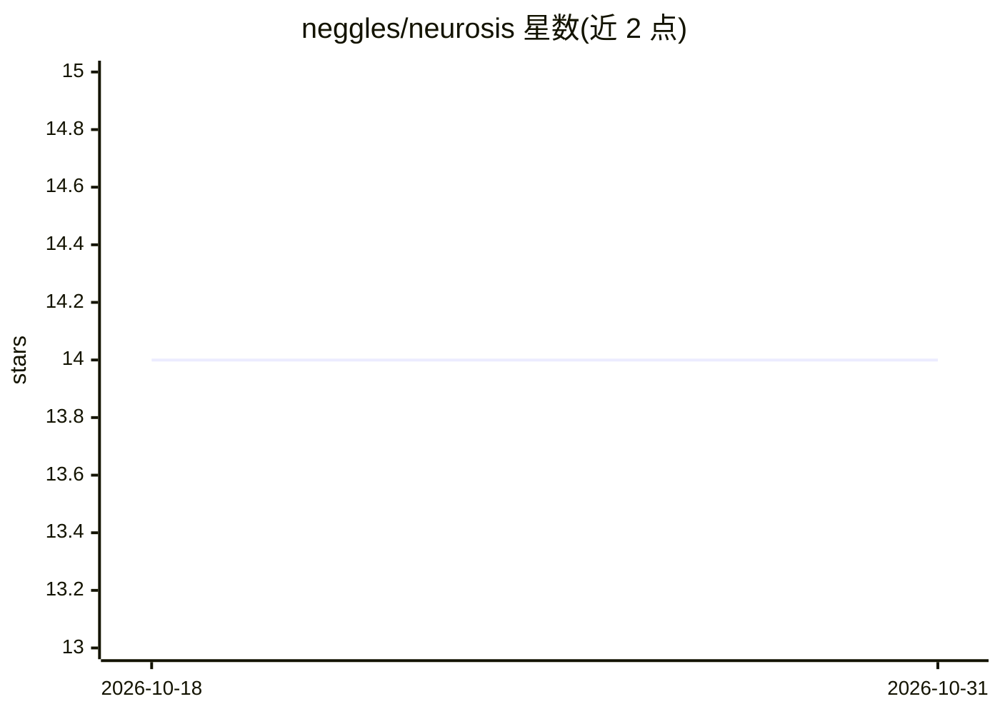

# neggles/neurosis

⭐ 14 · Python · NOASSERTION · 推送 2026-10-26 · [GitHub](https://github.com/neggles/neurosis) · 个人维护

**Stable Diffusion 扩散模型的 PyTorch Lightning 训练器**

基于 Stability-AI/generative-models 训练代码修改的扩散模型训练工具：迁移到 PyTorch Lightning 与 LightningCLI 配置管理，支持多 GPU/多节点训练、UNet 与各 TE 模块独立学习率、VAE 训练、W&B/TensorBoard 日志；数据集支持 Huggingface datasets、ImageFolder（方形/带 captions/宽高比分桶）与自定义数据集。作者自述代码尚不稳定、配置模板不完整，README 明确劝退一般用户。以 git clone 源码方式安装，另有 GitHub Packages 上的 Docker 镜像。GPLv3 许可。

## 筛选速览

| 维度 | 判定 | 备注 |
|---|---|---|
| AI 角色 | `ai-ecosystem` | LLM/agent 周边工具 |
| 许可风险 | `none` | NOASSERTION |
| 部署形态 | `library` | 以包/库形式分发 |
| 模型依赖 | — | README 未给出锁定关系 |
| 硬件要求 | — | 无带数字的原话,不猜 |
| 安装摩擦 | `low` | 无编译、无系统依赖或容器化 |
| 成熟度 | `idea` | |

## 能力要点

- PyTorch Lightning + LightningCLI 训练与配置管理
- 多 GPU/多节点训练与 UNet/TE 模块独立学习率
- 多种数据集支持：Huggingface datasets、ImageFolder 三种模式、自定义数据集
- 提供 GitHub Packages Docker 容器

## 适用场景

- 训练/微调 Stable Diffusion 类扩散模型
- 需要可读性较强的扩散模型训练代码做二次开发
- 多 GPU 环境下进行扩散模型训练实验

## 场景标签

`微调` `模型训练` · 领域:训练与推理

## 证据(README 行号)

> L3: a neural network trainer for ~~weebs~~ diffusion models.
> L16:  - Migration to full PyTorch Lightning

## 星数曲线

2026-10-18 14 → 2026-10-31 14（+0）

---
*卡片 v1 · prompt 1.4 · 生成 2026-10-31 · 置信度 mid · 依据 README sha `ca5e63d22c54` · [字段定义](../../DATASET.md)*
