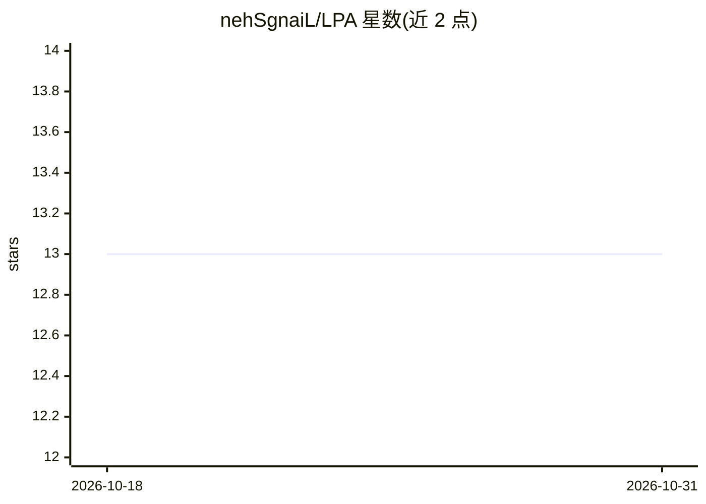

# nehSgnaiL/LPA

⭐ 13 · Python · 推送 2026-06-09 · [GitHub](https://github.com/nehSgnaiL/LPA) · [官网](https://nehsgnail.github.io/research/2025-IJDE-LPA/) · 组织维护

**科研者：用推断活动语义增强下一位置预测的 LSTM 模型代码**

论文 Improving Next Location Prediction with Inferred Activity Semantics in Mobile Phone Data 的官方代码仓库。LPA 框架将推断出的出行活动语义（多种活动类型）通过多模态嵌入与注意力机制整合进 LSTM 架构，用于手机数据上的下一位置预测。基于 PyTorch 与 LibCity 开发，内置示例数据，通过 args.py 配置活动类型（None/A3/A6），运行 main.py 或 run.sh 训练，产出训练日志、缓存数据集与模型检查点。

## 筛选速览

| 维度 | 判定 | 备注 |
|---|---|---|
| AI 角色 | `ai-native` | 本体是模型或模型工具 |
| 许可风险 | `none` | — |
| 部署形态 | `None` |  |
| 模型依赖 | — | README 未给出锁定关系 |
| 硬件要求 | — | 无带数字的原话,不猜 |
| 安装摩擦 | `low` | 无编译、无系统依赖或容器化 |
| 成熟度 | — | 结构信号不足 |

## 能力要点

- 活动语义推断与 LSTM 结合的多模态嵌入+注意力框架
- activity_type 参数支持 None/A3/A6 三种活动类型集成模式
- 提供示例数据与 run.sh 一键运行脚本

## 适用场景

- 复现论文中的下一位置预测实验
- 在自有手机轨迹数据上研究活动语义对预测的影响
- 基于 LibCity 数据格式扩展位置预测模型

## 场景标签

`科研工具` · 领域:学习与行业

## 证据(README 行号)

> L10: This repository contains the code and sample data for the LPA model from our paper, *Improving Next Location Predic
> L20: Specifically, a semantics-enhanced framework is proposed to infer and integrate user activities into an LSTM archit

## 星数曲线

2026-10-18 13 → 2026-10-31 13（+0）

---
*卡片 v1 · prompt 1.4 · 生成 2026-10-31 · 置信度 high · 依据 README sha `cba2643f6737` · [字段定义](../../DATASET.md)*
