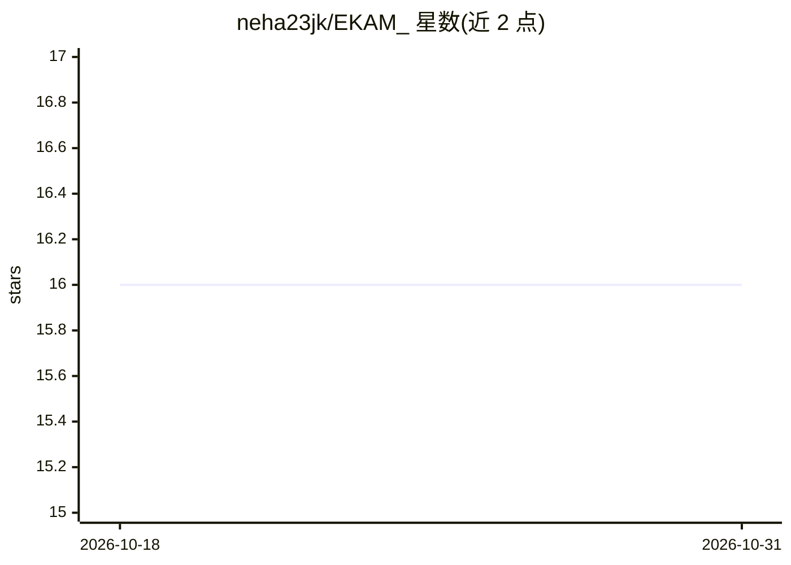

# neha23jk/EKAM_

⭐ 16 · 推送 2026-06-17 · [GitHub](https://github.com/neha23jk/EKAM_) · [官网](https://ekam-kohl.vercel.app/) · 个人维护

**面向组织者的 AI 赛事运营系统：自然语言生成蓝图并端到端执行**

全栈赛事运营平台（FastAPI + PostgreSQL + Next.js）。组织者用自然语言描述赛事，聊天代理抽取为 Universal Blueprint，经批准后按审批门控流水线运行注册、组队、评委分配、多轮评审到颁奖。AI 层用 Gemini（多 key 池）+ Groq 自动回退；OR-Tools CP-SAT 做组队与评委分配优化；scikit-learn 做评分异常检测与 TF-IDF 查重。内建 7 种赛事类型，未知格式映射到同一组原语。需自备 Gemini/Groq/Resend API key 与 Firebase 配置，本地源码部署。

## 筛选速览

| 维度 | 判定 | 备注 |
|---|---|---|
| AI 角色 | `ai-enhanced` | 去掉 AI 部分产品仍成立 |
| 许可风险 | `none` | — |
| 部署形态 | `library` | 以包/库形式分发 |
| 模型依赖 | locked-api |  |
| 硬件要求 | — | 无带数字的原话,不猜 |
| 安装摩擦 | `low` | 无编译、无系统依赖或容器化 |
| 成熟度 | — | 结构信号不足 |

## 能力要点

- 自然语言描述 → Universal Blueprint → 审批后端到端运行赛事流水线
- CP-SAT 约束优化组队与评委分配
- Isolation Forest 评分异常检测与 TF-IDF 查重
- Gemini 多 key 池 + Groq 自动回退的 LLM 层

## 适用场景

- 组织者用一句话描述赛事，自动生成完整赛程并执行
- 黑客松/辩论赛/淘汰赛等多格式赛事的组队与评委分配
- 检测评委评分异常与参赛作品抄袭

## 场景标签

`工作流自动化` · 领域:效率与自动化

## 证据(README 行号)

> L15: **EKAM** is an **AI-driven event operating system**. An organizer *describes* a
> L44: - **AI for event *design*** — not just form-filling, but inferring the full pipeline

## 星数曲线

2026-10-18 16 → 2026-10-31 16（+0）

---
*卡片 v1 · prompt 1.4 · 生成 2026-10-30 · 置信度 mid · 依据 README sha `52e2653d9f10` · [字段定义](../../DATASET.md)*
