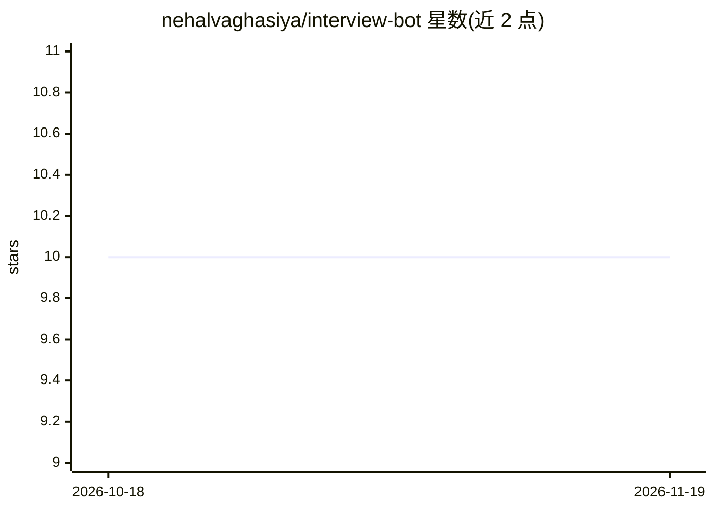

# nehalvaghasiya/interview-bot

⭐ 10 · Python · 推送 2025-11-24 · [GitHub](https://github.com/nehalvaghasiya/interview-bot) · 个人维护

**模拟真实面试练习的 AI 虚拟面试机器人**

基于 OpenAI GPT 模型与 Streamlit 框架的面试练习应用，包含三个环节：根据可配置的职位描述生成面试问题、通过聊天界面收集候选人回答、由 LLM 对照职位要求评估回答。默认使用 GPT-4o-mini，支持配置自定义 OpenAI 兼容端点，也支持切换到 Ollama 本地模型（llama3.2 等）。通过 .env 配置 LLM 提供方，用 streamlit run 启动后在浏览器访问。

## 筛选速览

| 维度 | 判定 | 备注 |
|---|---|---|
| AI 角色 | `ai-native` | 本体是模型或模型工具 |
| 许可风险 | `none` | — |
| 部署形态 | `None` |  |
| 模型依赖 | local-ok | 支持本地模型 |
| 硬件要求 | — | 无带数字的原话,不猜 |
| 安装摩擦 | `low` | 无编译、无系统依赖或容器化 |
| 成熟度 | — | 结构信号不足 |

## 能力要点

- 按可配置职位描述生成岗位面试问题
- AI 评估候选人回答与职位要求的匹配度
- 支持 OpenAI 与 Ollama 两种 LLM 提供方，兼容自定义 OpenAI 兼容端点
- 提供 uv 与 pip 两种安装方式

## 适用场景

- 求职者模拟特定岗位的面试问答
- 针对自定义职位描述练习针对性问题
- 无网络或隐私场景下用 Ollama 本地模型练习面试

## 场景标签

`聊天机器人` · 领域:对话与助手

## 证据(README 行号)

> L7: This project is an AI Interview Chatbot that uses OpenAI's GPT models (GPT-4o-mini by default) and the Streamlit fra
> L19: The project uses OpenAI's API with support for custom base URLs, making it compatible with OpenAI-compatible endpoi
> L253: #### OpenAI

## 星数曲线

2026-10-18 10 → 2026-11-19 10（+0）

---
*卡片 v1 · prompt 1.4 · 生成 2026-11-19 · 置信度 high · 依据 README sha `e4eee0821f9c` · [字段定义](../../DATASET.md)*
