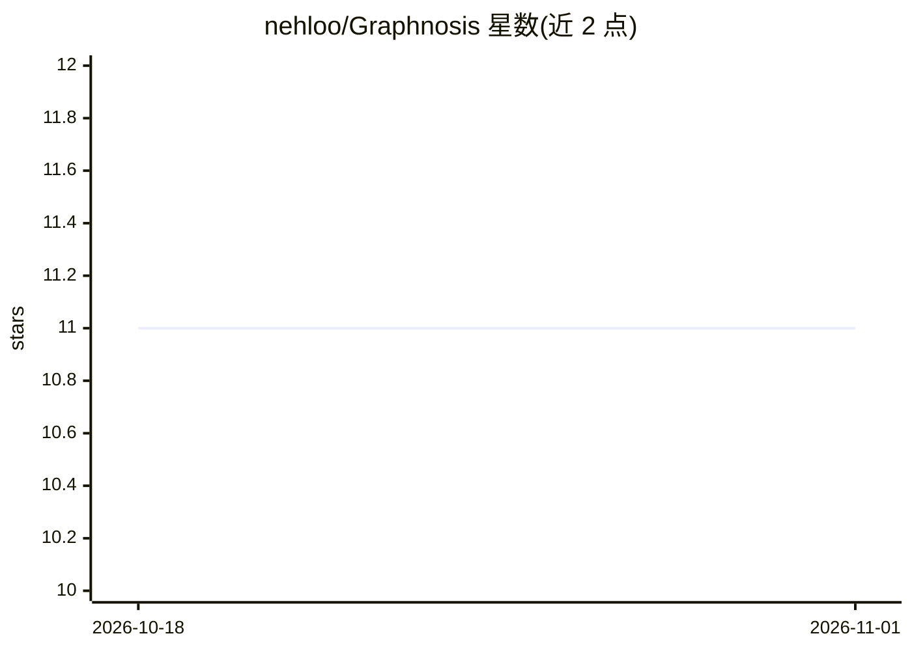

# nehloo/Graphnosis

⭐ 11 · TypeScript · Apache-2.0 · 推送 2026-08-15 · [GitHub](https://github.com/nehloo/Graphnosis) · [官网](https://graphnosis.com) · 个人维护

**面向 AI harness 的多图记忆库：以双图结构替代 .md 文件与 RAG 分块**

TypeScript 实现的 AI 记忆层：在一组节点上同时维护有向类型边（causes/supersedes 等）与无向关联边，BFS 一次走查两层，检索返回子图而非排序段落。检索从固定 .gai 文件出发是确定性的，同一问题给出同一子图；矛盾被保留并交由所有者裁决而非静默合并；节点带时间戳、置信度衰减与退休机制。默认 TF-IDF 词法检索，完全本地运行，无需 API key；embedding 与 LLM 摘要为可选路径。以 npm 库、CLI（demo/serve/mcp 三模式）与 HTTP 服务形式提供，可被任意语言经 process boundary 调用。

## 筛选速览

| 维度 | 判定 | 备注 |
|---|---|---|
| AI 角色 | `ai-ecosystem` | LLM/agent 周边工具 |
| 许可风险 | `permissive` | Apache-2.0 |
| 部署形态 | `library` | 以包/库形式分发 |
| 模型依赖 | — | README 未给出锁定关系 |
| 硬件要求 | — | 无带数字的原话,不猜 |
| 安装摩擦 | `low` | 无编译、无系统依赖或容器化 |
| 成熟度 | — | 结构信号不足 |

## 能力要点

- 有向/无向双图共存于同一节点集，一次 BFS 联合走查
- 固定 .gai 文件上的确定性检索，同一问题返回同一子graph
- 矛盾显式上报由所有者裁决，supersession 为边而非删除
- 默认 TF-IDF 本地检索，无需 API key 与网络

## 适用场景

- 给 agent 或 Claude Desktop/Cursor/Zed 提供可审计的长期记忆
- 替代 .md 记忆文件或 RAG 分块，保留事实间的关系结构
- 需要检索结果可复现、可 diff 的 agent 调试与 CI 场景

## 场景标签

`Agent 记忆` `知识图谱` · 领域:Agent 开发

## 证据(README 行号)

> L107: **Retrieval returns a subgraph, not a ranked list.** The model receives the facts
> L135: **No API key, no network.** Lexical retrieval is the default and runs entirely

## 星数曲线

2026-10-18 11 → 2026-11-01 11（+0）

---
*卡片 v1 · prompt 1.4 · 生成 2026-11-01 · 置信度 high · 依据 README sha `9c441a8f51c0` · [字段定义](../../DATASET.md)*
