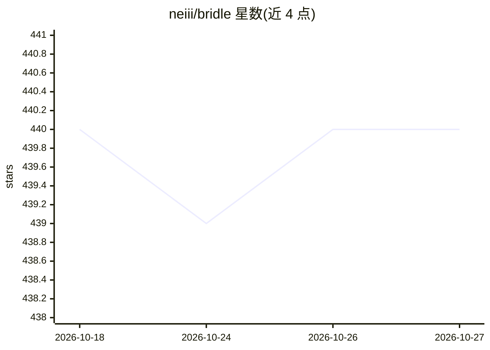

# neiii/bridle

⭐ 440 · Rust · MIT · 推送 2026-10-24 · [GitHub](https://github.com/neiii/bridle) · 个人维护

**多 AI 编码助手的统一配置管理器（TUI/CLI）**

用 Rust 编写的 TUI/CLI 工具，为 Claude Code、OpenCode、Goose、Amp、Copilot CLI、Crush 等 AI 编码助手提供统一的配置管理：每个 harness 可建多个 profile（如 work/personal）并一键切换；可从任意 GitHub 仓库安装 skills、agents、commands 和 MCPs，并自动转换各 harness 的路径、命名与 JSON/YAML schema 差异。Amp 为实验性支持，uninstall 命令标注 experimental。配置存于 ~/.config/bridle/config.toml。

## 筛选速览

| 维度 | 判定 | 备注 |
|---|---|---|
| AI 角色 | `ai-ecosystem` | LLM/agent 周边工具 |
| 许可风险 | `permissive` | MIT |
| 部署形态 | `library` | 以包/库形式分发 |
| 模型依赖 | — | README 未给出锁定关系 |
| 硬件要求 | — | 无带数字的原话,不猜 |
| 安装摩擦 | `low` | 无编译、无系统依赖或容器化 |
| 成熟度 | `idea` | |

## 能力要点

- 单命令在 6 种 AI 编码助手间切换配置 profile
- 从 GitHub 安装 skills/agents/commands/MCPs 并自动转换路径与 schema
- 提供交互式 TUI 与 JSON/text/auto 多种输出格式

## 适用场景

- 同时使用多个 AI 编码助手时统一管理配置
- 为同一助手维护 work/personal 等多套配置并快速切换
- 把为 Claude Code 写的技能安装到 OpenCode、Goose 等其他助手

## 场景标签

 · 领域:开发者工具/AI 编码助手基础设施

## 证据(README 行号)

> L5: Unified configuration manager for AI coding assistants. Manage profiles, install skills/agents/commands, and switch 
> L53: With Bridle, you're able to install skills, agents, commands, and MCPs from any GitHub repository, similar to how C
> L62: **Why this matters:** A skill written for Claude Code uses `~/.claude/skills/`. The same skill on OpenCode lives at

## 星数曲线

2026-10-18 440 → 2026-10-27 440（+0）

---
*卡片 v1 · prompt 1.4 · 生成 2026-10-21 · 置信度 high · 依据 README sha `0e97f965f9a5` · [字段定义](../../DATASET.md)*
