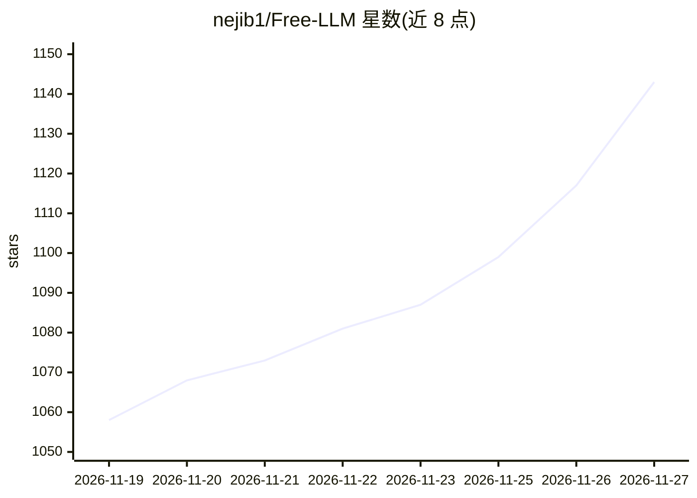

# nejib1/Free-LLM

⭐ 1,143 · JavaScript · MIT · 推送 2026-11-26 · [GitHub](https://github.com/nejib1/Free-LLM) · [官网](https://free-llm.com) · 个人维护 · 中文 README

**免费 LLM API 目录+本地路由：78 家供应商聚合到一个兼容端点**

由两部分组成：一是每晚从 free-llm.com 数据库重建的免费 LLM API 目录，覆盖 78 家供应商、450+ 免费模型，逐条标注速率限制与是否需要绑卡/手机号/邮箱，并跟踪免费档位的变动历史；二是 Free-LLM Router，将多个免费 key 聚合在本机一个 OpenAI/Anthropic 兼容地址后面，供应商繁忙或配额用尽时自动切换到下一个。README 提供 Python/JS/curl 请求示例，并给出 Claude Code、Codex、Cursor、OpenCode 接入免费模型的配置指引。通过 npm 全局安装运行。

## 筛选速览

| 维度 | 判定 | 备注 |
|---|---|---|
| AI 角色 | `ai-ecosystem` | LLM/agent 周边工具 |
| 许可风险 | `permissive` | MIT |
| 部署形态 | `library` | 以包/库形式分发 |
| 模型依赖 | local-ok | 支持本地模型 |
| 硬件要求 | — | 无带数字的原话,不猜 |
| 安装摩擦 | `low` | 无编译、无系统依赖或容器化 |
| 成熟度 | — | 结构信号不足 |

## 能力要点

- 78 家供应商、450+ 免费模型的目录，标注限制与注册要求
- 每晚从数据库重建，供应商失效自动更新
- Router 将多个免费 key 聚合到一个 OpenAI/Anthropic 兼容端点，带 failover
- 提供 Claude Code / Codex / Cursor / OpenCode 接入配置指南

## 适用场景

- 在不付费的情况下给 Claude Code、Codex 等编程助手找可用模型
- 把分散在多家供应商的小额免费额度合并成一个端点用
- 查询某家供应商免费档位是否需要绑卡、限速多少
- 对比多家供应商上同一开源模型的免费可用情况

## 场景标签

`模型网关` `精选清单` · 领域:Agent 开发

## 证据(README 行号)

> L19: Free LLM APIs come and go every week: a model is retired, a free tier starts asking for a card, a trial quietly end
> L88: Every provider above gives a *small* free plan, each with its own key and limits. The router stacks them: your app 
> L99: - **One address, every free key**: OpenAI, Anthropic Messages, Codex Responses, Ollama and MCP APIs

## 星数曲线

2026-11-19 1,058 → 2026-11-27 1,143（+85）

---
*卡片 v1 · prompt 1.4 · 生成 2026-11-27 · 置信度 high · 依据 README sha `a2594ca5c86f` · [字段定义](../../DATASET.md)*
