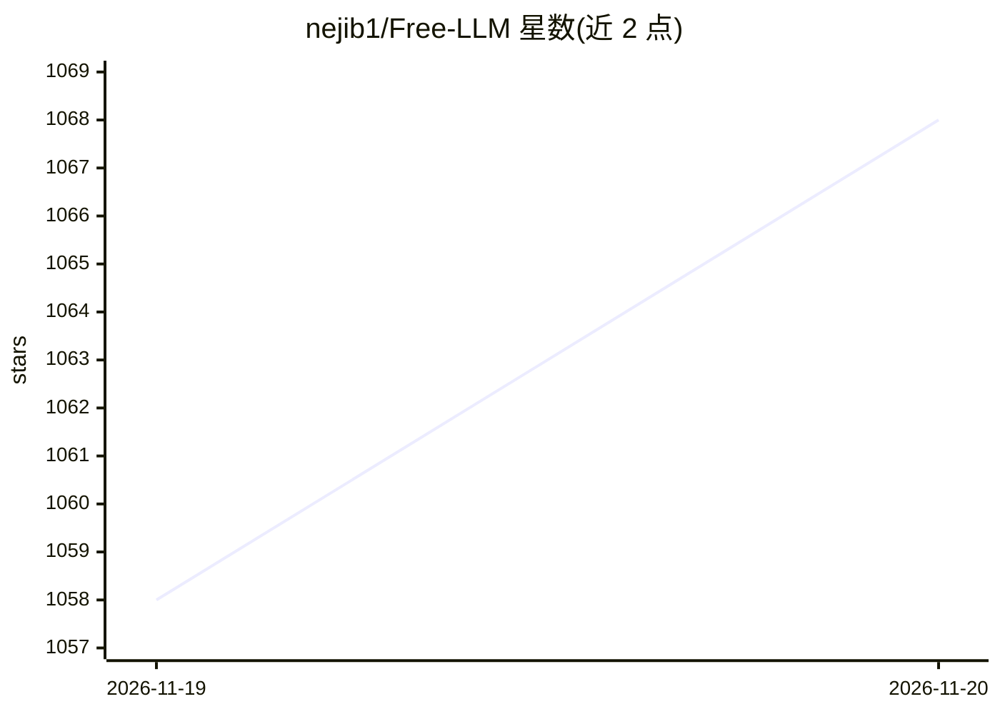

# nejib1/Free-LLM

⭐ 1,068 · JavaScript · MIT · 推送 2026-11-19 · [GitHub](https://github.com/nejib1/Free-LLM) · [官网](https://free-llm.com) · 个人维护

**免费 LLM API 目录+路由器：把各家免费额度聚合到一个端点**

由两部分组成：一是社区维护的免费 LLM API 目录（86 家 provider、450+ 免费模型），标注各家限额、是否需要信用卡/手机验证，提供 Python/JS/curl 示例与编码工具配置；二是 Free-LLM Router，本地运行的网关，把多个 provider 的免费计划聚合到一个 OpenAI/Anthropic 兼容地址，配额用尽或不可用时自动切换，密钥本机加密存储、无遥测。通过 npm 全局安装，提供 guest 模式与一条命令接入编码 agent。目录数据每日从 free-llm.com 同步。

## 筛选速览

| 维度 | 判定 | 备注 |
|---|---|---|
| AI 角色 | `ai-ecosystem` | LLM/agent 周边工具 |
| 许可风险 | `permissive` | MIT |
| 部署形态 | `library` | 以包/库形式分发 |
| 模型依赖 | local-ok | 支持本地模型 |
| 硬件要求 | — | 无带数字的原话,不猜 |
| 安装摩擦 | `low` | 无编译、无系统依赖或容器化 |
| 成熟度 | — | 结构信号不足 |

## 能力要点

- 聚合多家免费 API 为单一 OpenAI/Anthropic 兼容端点，故障时即时切换
- 目录标注每家 provider 的限额、卡片/手机验证要求
- 路由器 100% 本地运行，密钥加密存储、零依赖、无遥测
- 一条命令为 Claude Code/Codex/Aider 等编码工具配置免费后端

## 适用场景

- 零成本跑 Claude Code、Cursor 等编码 agent
- 把多个平台的小额免费额度当一个大额度用
- 对比各 provider 的免费限额后选型接入

## 场景标签

`模型网关` `精选清单` · 领域:Agent 开发

## 证据(README 行号)

> L17: ## ⚡ New: Free-LLM Router — all these free APIs behind one address
> L19: **The idea:** every provider below gives a *small* free plan, each with its own key and limits. The router stacks t
> L31: Works with zero keys to try (guest mode) · one-command setup for coding agents · OpenAI, Anthropic, Codex Responses

## 星数曲线

2026-11-19 1,058 → 2026-11-20 1,068（+10）

---
*卡片 v1 · prompt 1.4 · 生成 2026-11-19 · 置信度 high · 依据 README sha `091a9ec11929` · [字段定义](../../DATASET.md)*
