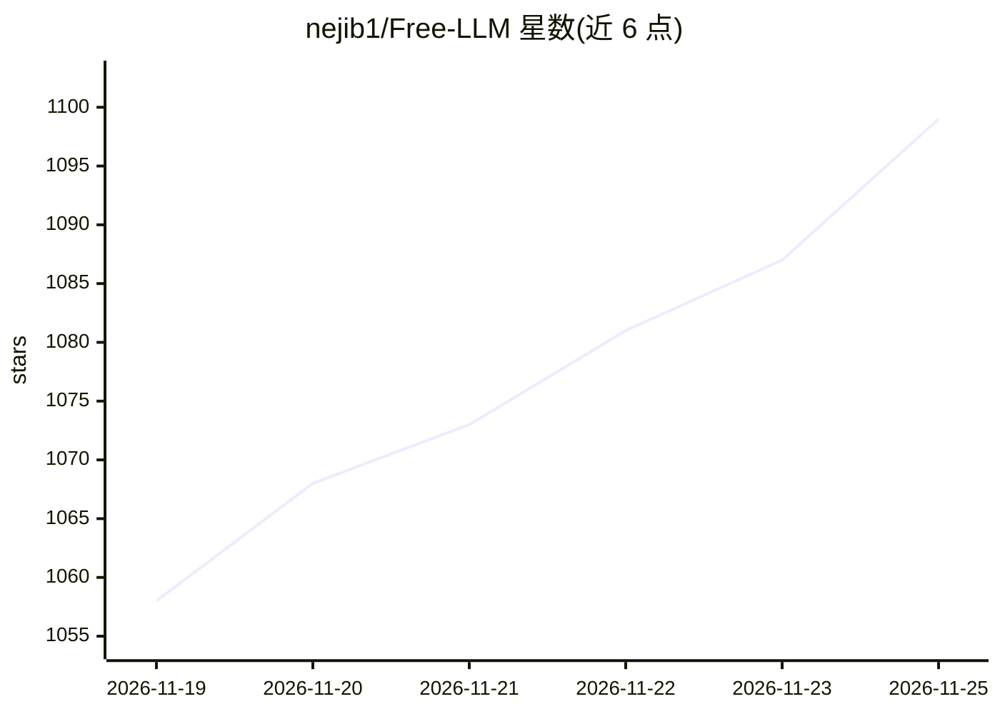

# nejib1/Free-LLM

⭐ 1,099 · JavaScript · MIT · 推送 2026-11-24 · [GitHub](https://github.com/nejib1/Free-LLM) · [官网](https://free-llm.com) · 个人维护 · 中文 README

**免费 LLM API 目录与本地路由器：聚合 79 家免费接口**

维护免费 LLM API 的结构化目录：收录 79 家提供免费额度的供应商、460+ 模型，标注各家速率限制、是否需要信用卡/手机验证，并按永久免费/可续积分等方式分类，数据每日同步、附免费额度变更日志。附带的 Free-LLM Router 在本地运行，将多家免费 API 折叠为一个 OpenAI/Anthropic 兼容端点，配额耗尽或不可用时自动切换；密钥本地加密存储。目标用户是需要零成本调用 LLM 的开发者与编程工具用户。

## 筛选速览

| 维度 | 判定 | 备注 |
|---|---|---|
| AI 角色 | `ai-knowledge` | 知识聚合/清单类 |
| 许可风险 | `permissive` | MIT |
| 部署形态 | `library` | 以包/库形式分发 |
| 模型依赖 | local-ok | 支持本地模型 |
| 硬件要求 | — | 无带数字的原话,不猜 |
| 安装摩擦 | `low` | 无编译、无系统依赖或容器化 |
| 成熟度 | — | 结构信号不足 |

## 能力要点

- 79 家免费 API 供应商、460+ 模型的结构化对比目录
- Free-LLM Router：一个 OpenAI/Anthropic 兼容端点聚合多家免费 API 并即时切换
- 标注各家是否需要信用卡/手机验证与速率限制
- 为 Claude Code、Cursor、Codex 等编程工具提供配置示例

## 适用场景

- 为编程助手找一个可白嫖的免费 LLM 后端
- 把多家免费额度的 API 聚合成一个稳定端点
- 跟踪各家供应商免费额度的变化

## 场景标签

`模型网关` `精选清单` · 领域:Agent 开发

## 证据(README 行号)

> L1: Free-LLM — Open Directory of Free AI &amp; LLM APIs
> L3:  460+ free LLM models from 79 free API providers — find, compare &amp; configure free models in seconds, plus 9 loca
> L24: **The idea:** every provider below gives a *small* free plan, each with its own key and limits. The router stacks t

## 星数曲线

2026-11-19 1,058 → 2026-11-25 1,099（+41）

---
*卡片 v1 · prompt 1.4 · 生成 2026-11-25 · 置信度 high · 依据 README sha `341b8856d58a` · [字段定义](../../DATASET.md)*
