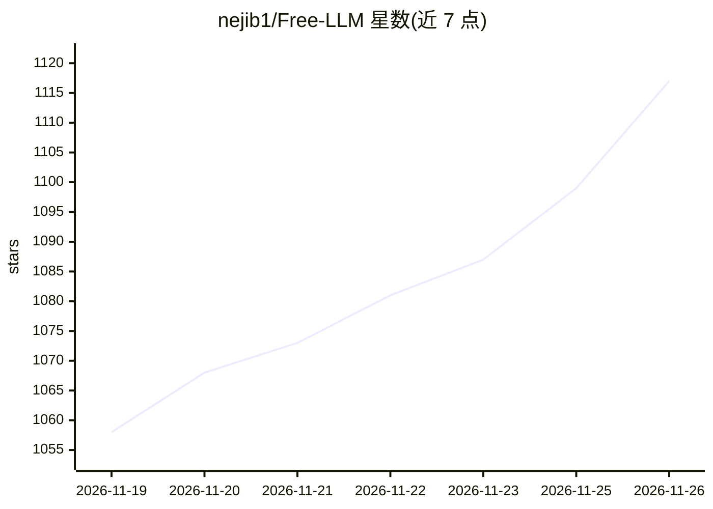

# nejib1/Free-LLM

⭐ 1,117 · JavaScript · MIT · 推送 2026-11-25 · [GitHub](https://github.com/nejib1/Free-LLM) · [官网](https://free-llm.com) · 个人维护 · 中文 README

**免费 LLM API 目录与聚合路由：一个端点接入多家免费模型**

由两部分组成：一是社区维护的免费 LLM API 提供商目录，收录 78 家提供商、450+ 免费模型，标注是否需要信用卡/手机验证、速率限制与免费层变更日志，数据每日从 free-llm.com 同步；二是 Free-LLM Router，将多家免费 API 聚合到单一 OpenAI/Anthropic 兼容端点，某家配额耗尽或不可用时即时切换。路由器本地运行，密钥加密存储、不上传，零依赖，提供针对 Claude Code、Codex、Cursor、Aider 等编码工具的一键配置。

## 筛选速览

| 维度 | 判定 | 备注 |
|---|---|---|
| AI 角色 | `ai-ecosystem` | LLM/agent 周边工具 |
| 许可风险 | `permissive` | MIT |
| 部署形态 | `library` | 以包/库形式分发 |
| 模型依赖 | local-ok | 支持本地模型 |
| 硬件要求 | — | 无带数字的原话,不猜 |
| 安装摩擦 | `low` | 无编译、无系统依赖或容器化 |
| 成熟度 | — | 结构信号不足 |

## 能力要点

- Free-LLM Router 将 78 家免费 API 聚合为一个 OpenAI/Anthropic 兼容端点并支持即时故障切换
- 目录标注每家提供商是否需要信用卡、手机验证或仅需邮箱，并跟踪免费层变更
- 本地运行：密钥加密存储在用户机器上，无账号、无遥测
- 提供 Python/JavaScript/curl 代码示例及各编码工具的逐工具配置

## 适用场景

- 让 Claude Code、Cursor 等编码代理运行在免费模型上
- 用一个小免费额度池替代单一提供商的配额限制
- 比较各家免费 LLM API 的限制、模型与注册门槛
- 查找当天仍提供免费层的提供商

## 场景标签

`模型网关` `精选清单` · 领域:Agent 开发

## 证据(README 行号)

> L24: **The idea:** every provider below gives a *small* free plan, each with its own key and limits. The router stacks t
> L63: This repo — backed by the live directory at **free-llm.com** — is a structured, community-maintained reference cove

## 星数曲线

2026-11-19 1,058 → 2026-11-26 1,117（+59）

---
*卡片 v1 · prompt 1.4 · 生成 2026-11-26 · 置信度 high · 依据 README sha `5bd7473c5b01` · [字段定义](../../DATASET.md)*
