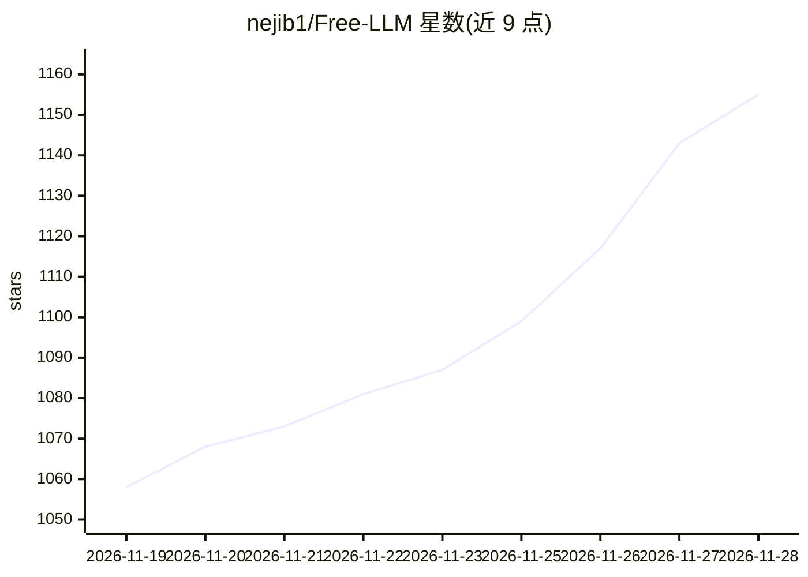

# nejib1/Free-LLM

⭐ 1,155 · JavaScript · MIT · 推送 2026-11-27 · [GitHub](https://github.com/nejib1/Free-LLM) · [官网](https://free-llm.com) · 个人维护

**免费 LLM API 目录 + 单端点聚合路由器，面向开发者和编码代理用户**

持续追踪免费 LLM API 的目录：收录 79 家提供商、460+ 免费模型，标注每家的注册要求（是否需卡/手机/邮箱）与速率限制，数据每晚从数据库重建并同步。附带 Free-LLM Router：通过 npm 安装后在本地运行，把多个免费 key 聚合到一个 OpenAI/Anthropic 兼容端点，配额用尽或限流时自动切换到下一个可用提供商，并提供针对 Claude Code、Codex、Cursor、Aider 的配置向导。

## 筛选速览

| 维度 | 判定 | 备注 |
|---|---|---|
| AI 角色 | `ai-ecosystem` | LLM/agent 周边工具 |
| 许可风险 | `permissive` | MIT |
| 部署形态 | `library` | 以包/库形式分发 |
| 模型依赖 | local-ok | 支持本地模型 |
| 硬件要求 | — | 无带数字的原话,不猜 |
| 安装摩擦 | `low` | 无编译、无系统依赖或容器化 |
| 成熟度 | — | 结构信号不足 |

## 能力要点

- 79 家免费 API 提供商与 460+ 免费模型的目录，含注册门槛与限额信息
- Free-LLM Router 将多个免费 key 聚合为单一 OpenAI/Anthropic 兼容端点并自动 failover
- 本地运行，key 加密存储，无遥测、零依赖
- 免费额度变动日志（新增/终止/缩减）每日更新

## 适用场景

- 为编码代理（Claude Code/Codex/Cursor/Aider）配置免费模型接入
- 对比不同提供商的免费额度与注册要求
- 用路由器把多家小额度免费 key 汇成一个稳定端点
- 本地运行模型实现无限制私有使用

## 场景标签

`模型网关` `精选清单` · 领域:Agent 开发

## 证据(README 行号)

> L3:  460+ free LLM models from 79 free API providers — find, compare &amp; configure free models in seconds, plus 9 loca
> L24: - 🔁 **Never hit a wall**: the Free-LLM Router stacks all your free keys behind one address
> L88: Every provider above gives a *small* free plan, each with its own key and limits. The router stacks them: your app 

## 星数曲线

2026-11-19 1,058 → 2026-11-28 1,155（+97）

---
*卡片 v1 · prompt 1.4 · 生成 2026-11-28 · 置信度 mid · 依据 README sha `1fdb26f50ede` · [字段定义](../../DATASET.md)*
