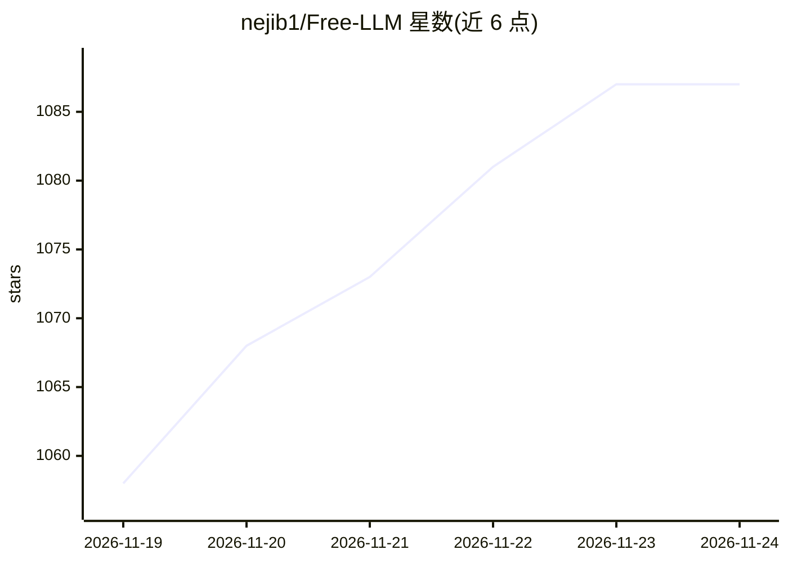

# nejib1/Free-LLM

⭐ 1,087 · JavaScript · MIT · 推送 2026-11-22 · [GitHub](https://github.com/nejib1/Free-LLM) · [官网](https://free-llm.com) · 个人维护 · 中文 README

**免费 LLM API 目录 + 聚合多免费源的路由器**

由社区维护的免费 LLM API 目录（free-llm.com 同步，每日更新），按永久免费额度与可续积分两类列出各厂商的限额、是否需信用卡及代表模型，并附各工具配置示例。另提供 Free-LLM Router：npm 安装后在本地运行，把多个免费 API 聚合到一个 OpenAI/Anthropic 兼容端点，某个源配额用尽时即时切换，密钥本地加密存储，支持 guest 模式与零依赖。

## 筛选速览

| 维度 | 判定 | 备注 |
|---|---|---|
| AI 角色 | `ai-ecosystem` | LLM/agent 周边工具 |
| 许可风险 | `permissive` | MIT |
| 部署形态 | `library` | 以包/库形式分发 |
| 模型依赖 | — | README 未给出锁定关系 |
| 硬件要求 | — | 无带数字的原话,不猜 |
| 安装摩擦 | `low` | 无编译、无系统依赖或容器化 |
| 成熟度 | — | 结构信号不足 |

## 能力要点

- 目录按限额、是否需卡/手机验证标注 94 个提供商
- Router 将多个免费 API 聚合为一个 OpenAI/Anthropic 兼容端点
- 配额用尽或源不可用时即时切换（failover）
- 本地运行、密钥加密存储、无遥测

## 适用场景

- 为编码助手（Claude Code、Cursor 等）配置免费模型后端
- 比较各免费 API 的限额与注册要求
- 用路由器把多个小额免费额度叠加使用

## 场景标签

`模型网关` `精选清单` · 领域:Agent 开发

## 证据(README 行号)

> L17: ## ⚡ New: Free-LLM Router — all these free APIs behind one address
> L19: **The idea:** every provider below gives a *small* free plan, each with its own key and limits. The router stacks t
> L31: Works with zero keys to try (guest mode) · one-command setup for coding agents · OpenAI, Anthropic, Codex Responses

## 星数曲线

2026-11-19 1,058 → 2026-11-24 1,087（+29）

---
*卡片 v1 · prompt 1.4 · 生成 2026-11-24 · 置信度 high · 依据 README sha `b27bccb65278` · [字段定义](../../DATASET.md)*
