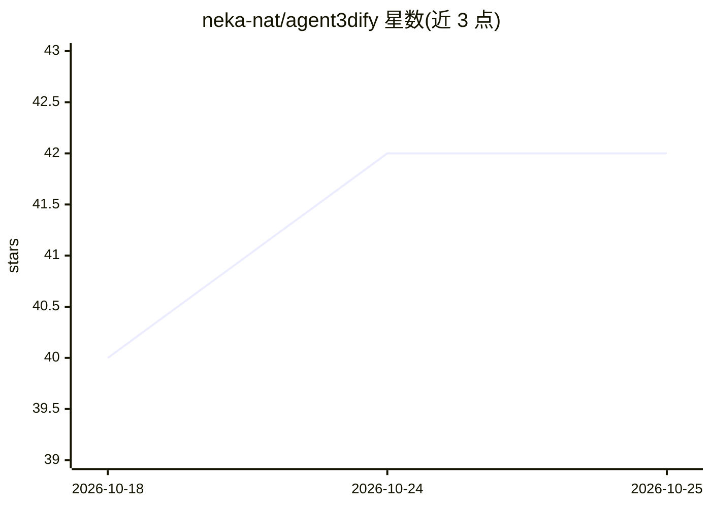

# neka-nat/agent3dify

⭐ 42 · Python · MIT · 推送 2026-06-25 · [GitHub](https://github.com/neka-nat/agent3dify) · 个人维护

**用多 AI agent 将 2D 图纸转换为 3D CAD 模型的工具**

基于 cad3dify 扩展的 agent 化系统：由根 agent 调度 image_editor 工具、CadQuery Builder 主子 agent 与可选的 Render Verifier 审查子 agent，从 2D 图纸图像生成 3D 模型。image_editor 为可选预处理（extract_view 路径使用 Gemini 图像理解检测并裁剪目标视图）。以 uv 管理的 Python 项目形式提供，需配置 .env 中的 API key，默认模型可直接运行，也支持通过参数指定 openai 等自定义模型。

## 筛选速览

| 维度 | 判定 | 备注 |
|---|---|---|
| AI 角色 | `ai-native` | 本体是模型或模型工具 |
| 许可风险 | `permissive` | MIT |
| 部署形态 | `None` |  |
| 模型依赖 | — | README 未给出锁定关系 |
| 硬件要求 | — | 无带数字的原话,不猜 |
| 安装摩擦 | `low` | 无编译、无系统依赖或容器化 |
| 成熟度 | — | 结构信号不足 |

## 能力要点

- 根 agent 调度 image_editor/CadQuery Builder/Render Verifier 的多 agent 架构
- extract_view 预处理使用 Gemini 图像理解检测并裁剪目标视图
- CLI 方式运行：uv run agent3dify 指定图纸文件
- 支持通过 --model 参数切换 openai 等模型

## 适用场景

- 把 2D 机械/工程图纸转成 3D CAD 模型
- 通过 AI agent 流水线自动完成建模与渲染校验
- 在自定义 LLM 后端下批量处理图纸图像

## 场景标签

`多智能体` · 领域:Agent 开发

## 证据(README 行号)

> L3: A tool for converting 2D drawings into 3D models using a combination of AI agents.
> L8: - CadQuery Builder

## 星数曲线

2026-10-18 40 → 2026-10-25 42（+2）

---
*卡片 v1 · prompt 1.4 · 生成 2026-10-25 · 置信度 mid · 依据 README sha `3bfed33d294f` · [字段定义](../../DATASET.md)*
