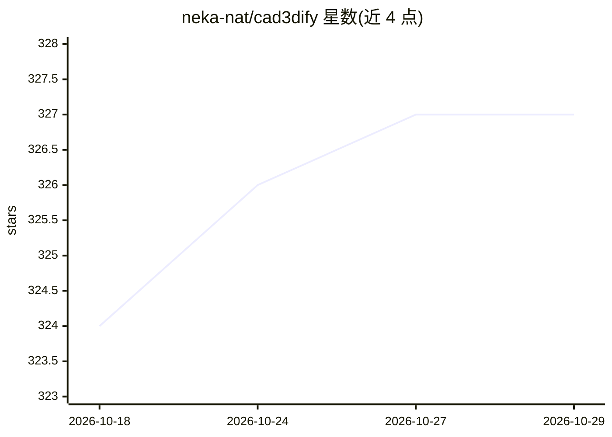

# neka-nat/cad3dify

⭐ 327 · Python · MIT · 推送 2026-04-07 · [GitHub](https://github.com/neka-nat/cad3dify) · 个人维护

**用 VLM 从 2D CAD 图像生成 3D CAD 模型（STEP 文件）**

面向开发者的工具：输入 2D CAD 图像，通过多 agent 流水线（CAD 代码生成 agent + Python 执行调试 agent）生成 CadQuery Python 代码并输出 STEP 格式 3D 模型文件。支持 GPT-5、Claude 4.5、Gemini 3 pro、Vertex AI 上的 Llama 3.2 等模型，提供 CLI 与 Streamlit 界面，用 Poetry 管理依赖、需设置相应 API key。README 提示作者另开发了 agent 版本 agent3dify 可替代本项目。

## 筛选速览

| 维度 | 判定 | 备注 |
|---|---|---|
| AI 角色 | `ai-native` | 本体是模型或模型工具 |
| 许可风险 | `permissive` | MIT |
| 部署形态 | `None` |  |
| 模型依赖 | locked-api |  |
| 硬件要求 | — | 无带数字的原话,不猜 |
| 安装摩擦 | `low` | 无编译、无系统依赖或容器化 |
| 成熟度 | — | 结构信号不足 |

## 能力要点

- 2D CAD 图像 → STEP 格式 3D 模型文件
- CAD 代码生成 agent 与 Python 执行调试 agent 两段式流水线
- 多模型可选：GPT-5 / Claude 4.5 / Gemini 3 pro / Llama 3.2 (Vertex AI)
- 提供 CLI 与 Streamlit 应用两种运行方式

## 适用场景

- 把已有 2D 工程图转成可编辑的 3D STEP 模型
- CAD 设计流程中用 VLM 加速建模起步
- 研究 VLM 在工程图纸理解与代码生成中的应用

## 场景标签

`代码生成` `多模态` · 领域:编码与开发

## 证据(README 行号)

> L3: Using GPT-5 (or Claude 4.5 opus, Gemini 3 pro, Llama 3.2 on Vertex AI), generate a 3D CAD model (STEP file) from a 2
> L41:     Input((Input Image)) --> CodeGenerator(CAD Code Generator AI Agent)
> L42:     CodeGenerator --> PythonDebugger(Python Execution and Debugging AI Agent)

## 星数曲线

2026-10-18 324 → 2026-10-29 327（+3）

---
*卡片 v1 · prompt 1.4 · 生成 2026-10-21 · 置信度 high · 依据 README sha `6ce50969c323` · [字段定义](../../DATASET.md)*
