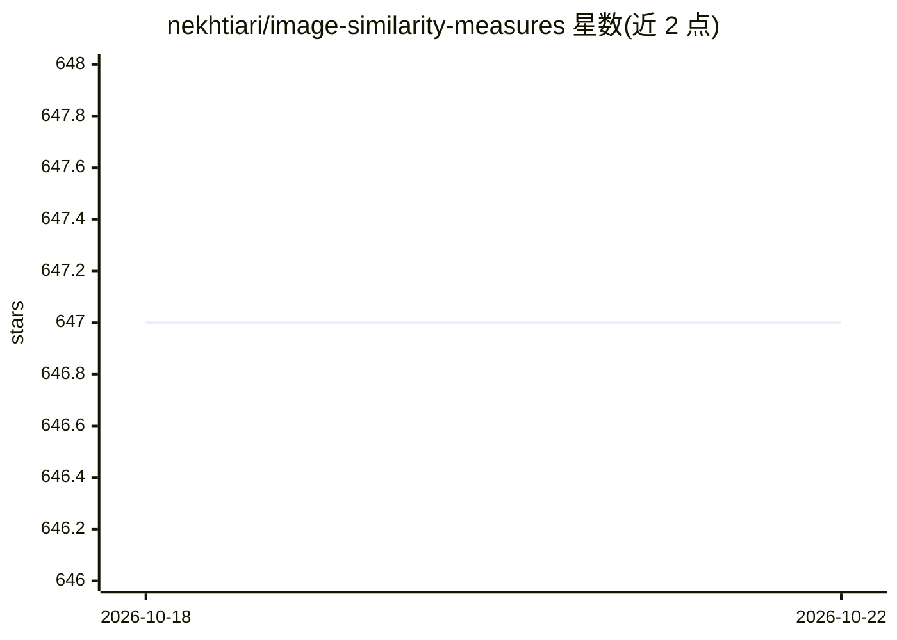

# nekhtiari/image-similarity-measures

⭐ 647 · Python · MIT · 推送 2026-09-05 · [GitHub](https://github.com/nekhtiari/image-similarity-measures) · 组织维护

**Python 包与命令行工具：八种指标度量两图像相似度**

提供图像相似度评估的 Python 包与命令行工具，实现 RMSE、PSNR、SSIM、FSIM、ISSM、SRE、SAM、UIQ 八种度量。支持 Python >=3.10，通过 pip 安装；可选 pyfftw 加速 FSIM 计算，可选 rasterio 替代 OpenCV 读取 TIFF。命令行输出机器可读的 JSON 结果，也可在 Python 中直接调用单个指标函数。引文指向多光谱卫星图像超分辨率研究的论文。

## 筛选速览

| 维度 | 判定 | 备注 |
|---|---|---|
| AI 角色 | `ai-ecosystem` | LLM/agent 周边工具 |
| 许可风险 | `permissive` | MIT |
| 部署形态 | `library` | 以包/库形式分发 |
| 模型依赖 | — | README 未给出锁定关系 |
| 硬件要求 | — | 无带数字的原话,不猜 |
| 安装摩擦 | `low` | 无编译、无系统依赖或容器化 |
| 成熟度 | — | 结构信号不足 |

## 能力要点

- 八种图像相似度/质量指标（RMSE/PSNR/SSIM/FSIM/ISSM/SRE/SAM/UIQ）
- 同时提供命令行工具与 Python API
- 命令行输出机器可读 JSON，支持逐指标选择
- 可选 pyfftw 加速与 rasterio 读取 TIFF

## 适用场景

- 评估图像生成/超分辨率/复原任务的输出质量
- 在管线中程序化比对原始图像与预测图像
- 快速命令行批量计算多种相似度指标

## 场景标签

`图像视频处理` · 领域:感知与多模态

## 证据(README 行号)

> L3: Python package and commandline tool to evaluate the similarity between two images with eight evaluation metrics:
> L76:  Müller, M. U., Ekhtiari, N., Almeida, R. M., and Rieke, C.: SUPER-RESOLUTION OF MULTISPECTRAL

## 星数曲线

2026-10-18 647 → 2026-10-22 647（+0）

---
*卡片 v1 · prompt 1.4 · 生成 2026-10-21 · 置信度 high · 依据 README sha `834d70b069db` · [字段定义](../../DATASET.md)*
