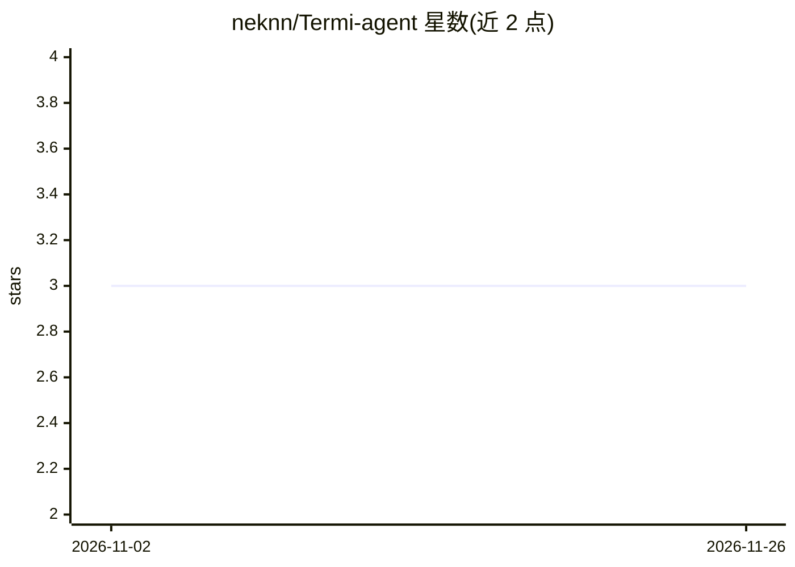

# neknn/Termi-agent

⭐ 3 · Python · MIT · 推送 2026-10-31 · [GitHub](https://github.com/neknn/Termi-agent) · 个人维护

**面向 Windows 的自主 AI 助手，带安全模式**

由约 9900 行单文件重构而来的模块化 Python 项目，包含 termi_core 包的 36 个模块。Agent 依据模型响应控制鼠标、键盘、窗口与文件并执行命令，提供网络搜索、Playwright 无头浏览器、截图与绘图动作、子代理及后台任务调度。安全机制包括危险命令模板检测、prompt injection 防护（/taint）、操作确认、keyring 密钥存储与 Windows Sandbox 沙箱选项。README 明确警告保护为启发式、非沙箱环境，需 Python 3.9+，模型调用费用由用户承担。

## 筛选速览

| 维度 | 判定 | 备注 |
|---|---|---|
| AI 角色 | `ai-native` | 本体是模型或模型工具 |
| 许可风险 | `permissive` | MIT |
| 部署形态 | `desktop` | 安装包/桌面程序 |
| 模型依赖 | — | README 未给出锁定关系 |
| 硬件要求 | — | 无带数字的原话,不猜 |
| 安装摩擦 | `low` | 无编译、无系统依赖或容器化 |
| 成熟度 | — | 结构信号不足 |

## 能力要点

- Agent 循环执行任务：鼠标、键盘、窗口、文件与命令操作，支持子代理
- 安全模式：危险命令模板匹配、prompt injection 污点跟踪（默认开启）
- keyring 密钥存储、config.json 原子写入与备份恢复
- python check.py 自检脚本与 unittest/pytest 测试，CI 覆盖 Windows/Linux

## 适用场景

- 让 AI 助手代替我在 Windows 上执行重复的桌面操作
- 需要可控确认机制的场景下运行自动化代理任务
- 在本机上用代理做网页搜索、截图分析等任务

## 场景标签

`AI 助手` `浏览器自动化` `GUI 自动化` · 领域:效率与自动化

## 证据(README 行号)

> L3: Autonomous AI assistant for Windows with a safe mode
> L54: |`llm`|запросы к моделям|
> L63: |`agent`|ядро `Agent`: цикл задачи, под-агенты|

## 星数曲线

2026-11-02 3 → 2026-11-26 3（+0）

---
*卡片 v1 · prompt 1.4 · 生成 2026-11-21 · 置信度 high · 依据 README sha `522049c31f53` · [字段定义](../../DATASET.md)*
