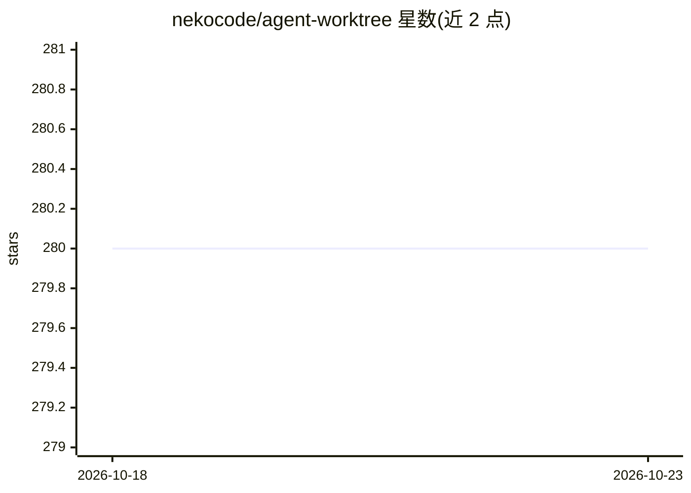

# nekocode/agent-worktree

⭐ 280 · Rust · MIT · 推送 2026-10-20 · [GitHub](https://github.com/nekocode/agent-worktree) · 个人维护 · 中文 README

**面向 AI 编码代理的 Git worktree 并行工作流工具**

npm 全局安装的命令行工具，基于 Git worktree 为 AI 编码代理提供隔离工作目录，支持多个代理并行执行互不干扰。核心机制是 wt run 引擎：创建 worktree、注入 WT_* 环境变量运行代理、按结果（无变更/仅提交/未提交变更/合并冲突）分发为清理、合并或保留；提供交互式与 headless（CI/编排器）两种模式，JSON 输出与退出码表。还包含 worktree 增删改查、合并/同步策略、copy_files 与钩子机制。支持 bash/zsh/fish/PowerShell。MIT 许可。

## 筛选速览

| 维度 | 判定 | 备注 |
|---|---|---|
| AI 角色 | `ai-ecosystem` | LLM/agent 周边工具 |
| 许可风险 | `permissive` | MIT |
| 部署形态 | `desktop` | 安装包/桌面程序 |
| 模型依赖 | — | README 未给出锁定关系 |
| 硬件要求 | — | 无带数字的原话,不猜 |
| 安装摩擦 | `low` | 无编译、无系统依赖或容器化 |
| 成熟度 | — | 结构信号不足 |

## 能力要点

- wt run 引擎：创建 worktree→运行代理→按结果分发（merge/keep/cleanup）
- 交互式（-i）与 headless（--on-success/--json）两种模式，退出码区分结果
- copy_files 按 gitignore 风格模式复制文件，支持 copy-on-write
- 钩子经 sh -c 运行且向脚本注入 WT_MAIN_REPO 等 4 个环境变量

## 适用场景

- 同时运行多个 AI 编码代理并行开发不同功能
- CI 或编排器中按声明策略自动运行代理并合并结果
- 为每个功能分支维护隔离的 Git worktree 工作目录

## 场景标签

`编码 Agent` `工作流自动化` · 领域:效率与自动化

## 证据(README 行号)

> L5: A Git worktree workflow tool for AI coding agents. Enables parallel development with isolated environments.
> L62: One engine: create worktree → run agent inside (`WT_*` env vars injected) →

## 星数曲线

2026-10-18 280 → 2026-10-23 280（+0）

---
*卡片 v1 · prompt 1.4 · 生成 2026-10-22 · 置信度 high · 依据 README sha `c31ba56842a3` · [字段定义](../../DATASET.md)*
