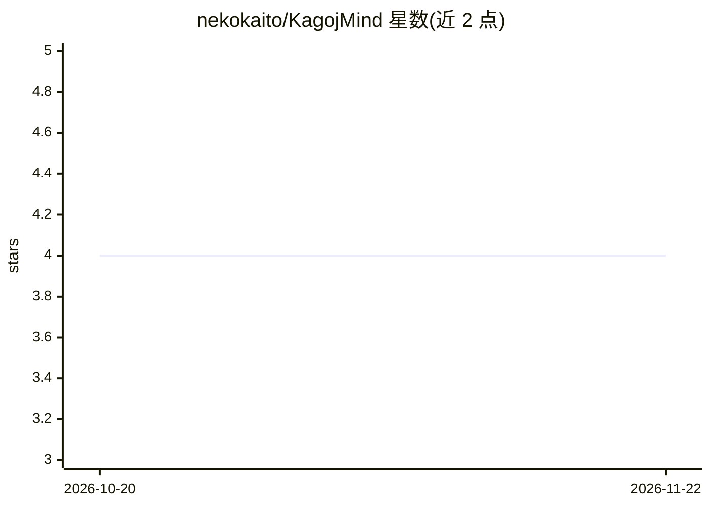

# nekokaito/KagojMind

⭐ — · [GitHub]() · 个人维护

**文档智能工作区：上传文档并获取带来源引用的 RAG 问答**

KagojMind 是一个基于 Next.js 与 Supabase 的文档智能 SaaS 应用：用户上传 PDF/DOCX，系统抽取文本并分块，经嵌入后存入 pgvector 做语义检索，问题以检索到的片段作为上下文交给 Google Gemini 生成带来源引用的回答，另提供 AI 摘要、集合管理与英/孟加拉双语界面。需自备 Supabase 项目与 Gemini API key，README 自述为 Portfolio/MVP 项目，功能取决于当前实现与外部服务配置。

## 筛选速览

| 维度 | 判定 | 备注 |
|---|---|---|
| AI 角色 | `ai-native` | 本体是模型或模型工具 |
| 许可风险 | `none` | — |
| 部署形态 | `library` | 以包/库形式分发 |
| 模型依赖 | — | README 未给出锁定关系 |
| 硬件要求 | — | 无带数字的原话,不猜 |
| 安装摩擦 | `low` | 无编译、无系统依赖或容器化 |
| 成熟度 | `idea` | |

## 能力要点

- 上传→抽取→分块→嵌入→检索→生成的完整 RAG 流程，回答附带来源引用
- pgvector 向量相似度语义搜索
- Supabase RLS 与私有存储桶的权限控制
- 英文与孟加拉语双语界面及明暗主题

## 适用场景

- 上传 PDF/DOCX 并对内容提问，获得带出处的回答
- 自动生成文档摘要与要点
- 在文档集合中做语义检索

## 场景标签

`RAG` `语义搜索` `文档问答` · 领域:知识与检索

## 证据(README 行号)

> L5: An AI-powered document intelligence workspace for uploading documents,
> L12: KagojMind is a document intelligence SaaS application designed to make
> L67: KagojMind uses Retrieval-Augmented Generation (RAG) to ground AI

## 星数曲线

2026-10-20 4 → 2026-11-22 4（+0）

---
*卡片 v1 · prompt 1.4 · 生成 2026-11-21 · 置信度 high · 依据 README sha `b4be2beb85eb` · [字段定义](../../DATASET.md)*
