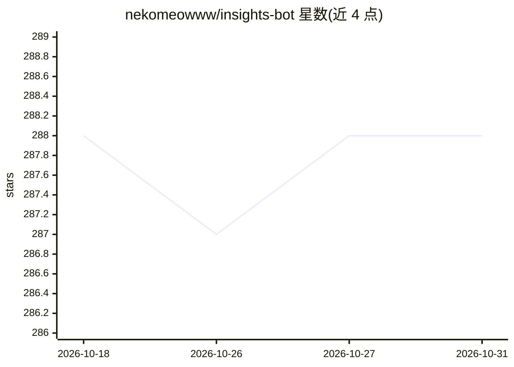

# nekomeowww/insights-bot

⭐ 288 · Go · MIT · 推送 2026-02-11 · [GitHub](https://github.com/nekomeowww/insights-bot) · 个人维护 · 中文 README

**接入 GPT 的信息流摘要机器人，面向 Telegram/Slack/Discord 用户**

用 Go 编写的聊天机器人，接入 OpenAI GPT 模型为 IM 信息流提供摘要：/smr 命令总结网页、/recap 总结聊天记录、/subscribe_recap 订阅群聊回顾并通过私聊推送、/recap_forwarded 总结转发的消息。支持 Telegram、Slack、Discord 三种 IM，其中聊天记录回顾类命令目前仅在 Telegram 可用。运行需配置 OpenAI API Key、PostgreSQL 与 Redis；支持 OpenAI API Host 反代与模型名替换。提供 Docker 镜像、docker-compose 与源码 go build 两种部署方式。

## 筛选速览

| 维度 | 判定 | 备注 |
|---|---|---|
| AI 角色 | `ai-native` | 本体是模型或模型工具 |
| 许可风险 | `permissive` | MIT |
| 部署形态 | `self-host` | docker 或自建部署 |
| 模型依赖 | — | README 未给出锁定关系 |
| 硬件要求 | — | 无带数字的原话,不猜 |
| 安装摩擦 | `low` | 无编译、无系统依赖或容器化 |
| 成熟度 | — | 结构信号不足 |

## 能力要点

- 网页摘要（/smr）与聊天记录回顾（/recap、/subscribe_recap）
- 支持 Telegram、Slack、Discord 三种 IM 接入
- 可通过 OPENAI_API_HOST 配置反代/中继，可替换模型名
- 提供 Docker Hub 镜像与 docker-compose 部署

## 适用场景

- 在群聊中订阅定时聊天回顾并推送到私聊
- 把网页链接发给机器人获取摘要
- 转发一批消息后让机器人统一总结

## 场景标签

`聊天机器人` · 领域:对话与助手

## 证据(README 行号)

> L19: A bot works with OpenAI GPT models to provide insights for your info flows.
> L52: By sending `/smr` command with a URL or replying to a message that only contains a URL, the bot will try to summari
> L239: |`OPENAI_API_SECRET`|`true`||OpenAI API Secret Key that looks like `sk-*******************************************

## 星数曲线

2026-10-18 288 → 2026-10-31 288（+0）

---
*卡片 v1 · prompt 1.4 · 生成 2026-10-22 · 置信度 high · 依据 README sha `b827de69f046` · [字段定义](../../DATASET.md)*
