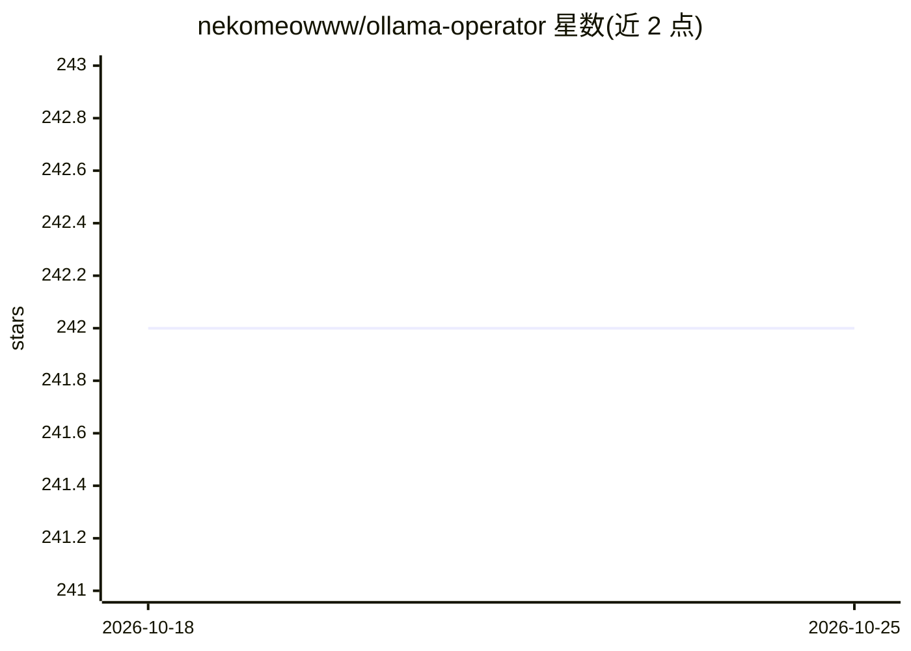

# nekomeowww/ollama-operator

⭐ 242 · Go · Apache-2.0 · 推送 2026-10-23 · [GitHub](https://github.com/nekomeowww/ollama-operator) · [官网](https://ollama-operator.ayaka.io) · 个人维护

**在 Kubernetes 上运行 Ollama 大模型的运维算子**

基于 Ollama 的 Kubernetes Operator：通过 CRD（Model CR）声明式地在集群中部署大模型，自动创建 gRPC 推理服务 Deployment 与存储模型镜像的 StatefulSet/PersistentVolume，实现同一集群运行多个模型、节点级镜像共享、经 Service/Ingress 暴露。兼容 Ollama 模型、API 与 CLI，支持任意 GGUF 格式模型，附带 kollama 命令行工具简化操作。依托 llama.cpp，无需 Python 环境与 CUDA 驱动；可在通用集群、K3s（树莓派/TrueNAS）、kind、minikube 上运行，无除 Kubernetes 外的额外依赖。

## 筛选速览

| 维度 | 判定 | 备注 |
|---|---|---|
| AI 角色 | `ai-ecosystem` | LLM/agent 周边工具 |
| 许可风险 | `permissive` | Apache-2.0 |
| 部署形态 | `library` | 以包/库形式分发 |
| 模型依赖 | local-ok | 支持本地模型 |
| 硬件要求 | — | 无带数字的原话,不猜 |
| 安装摩擦 | `medium` | 含编译或系统依赖之一 |
| 成熟度 | — | 结构信号不足 |

## 能力要点

- 声明式 Model CRD 在集群中部署多个 LLM 推理服务
- 兼容 Ollama 全部模型、API 与 CLI，支持 GGUF 模型打包
- 附带 kollama CLI 一条命令部署并暴露模型
- 仅需 Kubernetes，支持 K3s/kind/minikube 等环境

## 适用场景

- 在 Kubernetes 集群上集中运行和共享多个本地大模型
- 用声明式配置管理模型部署与持久化存储
- 把集群内模型通过 Service/Ingress 暴露给应用调用

## 场景标签

`推理引擎` · 领域:训练与推理

## 证据(README 行号)

> L15: - Install the operator on your Kubernetes cluster
> L16: - Apply the needed CRDs
> L155: 1. **Model Inferencing Server**: The model inferencing server is a gRPC server that runs the model and serves the 

## 星数曲线

2026-10-18 242 → 2026-10-25 242（+0）

---
*卡片 v1 · prompt 1.4 · 生成 2026-10-22 · 置信度 high · 依据 README sha `f82b60551f9a` · [字段定义](../../DATASET.md)*
