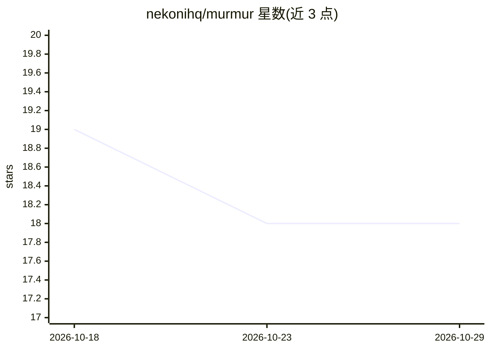

# nekonihq/murmur

⭐ 18 · TypeScript · MIT · 推送 2026-10-24 · [GitHub](https://github.com/nekonihq/murmur) · 个人维护

**手机 App 经蓝牙控制树莓派：AI Agent 下发 shell 命令**

由两部分组成：运行在 Pi 上的 Python 守护进程 murmurd（基于 BlueZ/bless 提供自定义 BLE GATT shell 服务），以及 iOS 端 React Native(Expo) 应用（含 xterm.js 终端与 Agent 聊天界面）。Agent 循环在手机端运行：手机持有用户自己的 LLM API key 并联网调用，将命令经 BLE 发给 Pi 执行，全程展示每条命令与输出，Pi 本身可完全离线。支持 Claude/OpenAI/Gemini/OpenRouter，密钥存于系统安全存储，无后端；murmurd 默认以非 root 用户运行且 systemd 单元做了加固。

## 筛选速览

| 维度 | 判定 | 备注 |
|---|---|---|
| AI 角色 | `ai-native` | 本体是模型或模型工具 |
| 许可风险 | `permissive` | MIT |
| 部署形态 | `library` | 以包/库形式分发 |
| 模型依赖 | locked-api |  |
| 硬件要求 | — | 无带数字的原话,不猜 |
| 安装摩擦 | `low` | 无编译、无系统依赖或容器化 |
| 成熟度 | — | 结构信号不足 |

## 能力要点

- Agent 循环在手机端运行，Pi 只需蓝牙、无需联网
- 支持自带 API key 接入 Claude/OpenAI/Gemini/OpenRouter
- 基于 GATT 的自定义分帧与流控协议（PROTOCOL.md）
- murmurd 非运行、systemd 加固默认阻止提权

## 适用场景

- 给无网络的无头树莓派下发自然语言目标让其自动执行命令
- 通过 BLE 用手机远程操作 Pi 的交互终端
- 现场排查 Pi 的磁盘、网络等系统问题

## 场景标签

`AI 助手` · 领域:对话与助手

## 证据(README 行号)

> L13: - **Agent mode** — a chat UI where an LLM (your choice of Anthropic Claude, OpenAI, Google
> L27: The agent loop runs **on the phone**: the phone holds the API key and the internet connection,
> L28: calls the LLM, and ships the resulting commands to the Pi over BLE. The Pi only ever needs

## 星数曲线

2026-10-18 19 → 2026-10-29 18（-1）

---
*卡片 v1 · prompt 1.4 · 生成 2026-10-29 · 置信度 mid · 依据 README sha `f9837337c499` · [字段定义](../../DATASET.md)*
