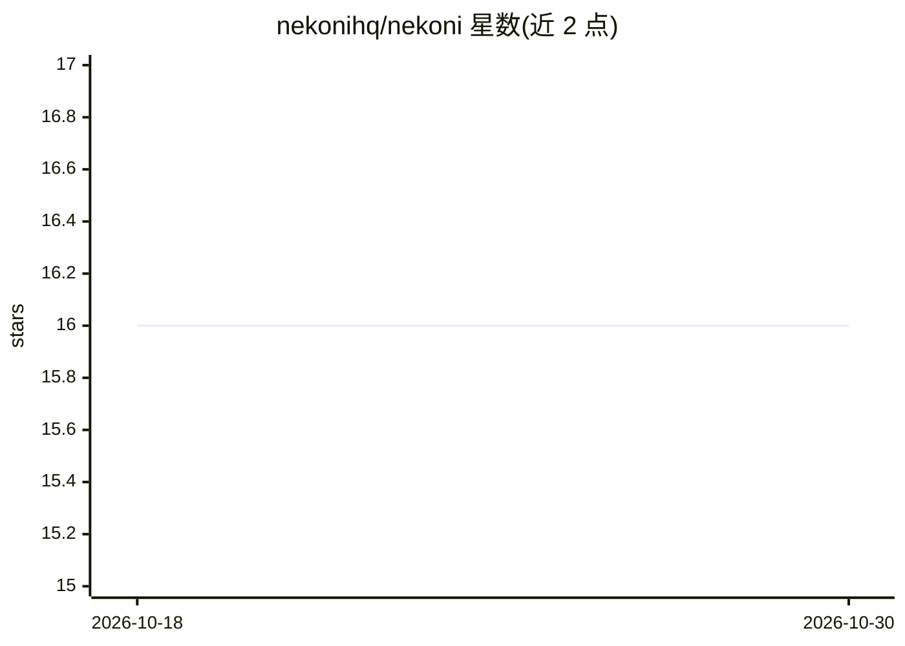

# nekonihq/nekoni

⭐ 16 · TypeScript · MIT · 推送 2026-10-24 · [GitHub](https://github.com/nekonihq/nekoni) · [官网](https://nekoni.dev) · 组织维护

**自托管本地 AI agent，通过 WebRTC 从手机访问家庭机器**

在用户自己的 macOS/Linux 机器上运行的自托管 AI agent：LLM 推理走 Ollama，向量检索用 ChromaDB，文档摄取基于 sentence-transformers，支持 PDF/DOCX/图片等格式含 OCR 的 RAG 问答，并提供带 cron 调度的可复用技能模板与 Python 扩展工具。手机或浏览器通过 WebRTC DataChannel 直连，公开信令服务器仅用于 SDP/ICE 交换，数据不经过云端；采用 Ed25519 密钥对互认。一键脚本安装依赖 Docker Desktop，模型约需 4GB 磁盘；Windows 需经 WSL2 运行。

## 筛选速览

| 维度 | 判定 | 备注 |
|---|---|---|
| AI 角色 | `ai-native` | 本体是模型或模型工具 |
| 许可风险 | `permissive` | MIT |
| 部署形态 | `None` |  |
| 模型依赖 | local-ok | 支持本地模型 |
| 硬件要求 | — | 无带数字的原话,不猜 |
| 安装摩擦 | `low` | 无编译、无系统依赖或容器化 |
| 成熟度 | — | 结构信号不足 |

## 能力要点

- Ollama 本地推理 + ChromaDB 向量检索 + sentence-transformers 嵌入
- 手机/浏览器经 WebRTC DataChannel 直连，公开信令仅用于 SDP/ICE 交换
- 多格式文档 RAG（PDF/DOCX/XLSX/PPTX/HTML/图片，含 OCR）
- 技能模板支持 cron 调度，可几行 Python 扩展工具

## 适用场景

- 在家部署私有 AI 助手并从手机访问
- 对自己的文档做本地 RAG 问答
- 在自己的硬件上运行定时自动化任务
- 构建自定义工具与 agent 技能

## 场景标签

`AI 助手` `RAG` `工作流自动化` · 领域:效率与自动化

## 证据(README 行号)

> L11: Nekoni is a self-hosted AI agent that runs on your machine and connects directly to your phone via WebRTC.
> L17: - **Fully local** — LLM inference via Ollama, embeddings via sentence-transformers, vector search via ChromaDB

## 星数曲线

2026-10-18 16 → 2026-10-30 16（+0）

---
*卡片 v1 · prompt 1.4 · 生成 2026-10-30 · 置信度 high · 依据 README sha `d11e3ca8189c` · [字段定义](../../DATASET.md)*
