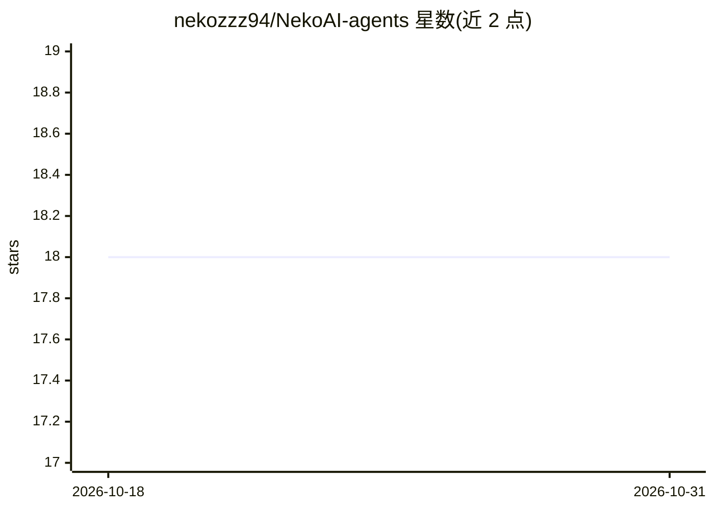

# nekozzz94/NekoAI-agents

⭐ 18 · Python · GPL-3.0 · 推送 2026-10-14 · [GitHub](https://github.com/nekozzz94/NekoAI-agents) · 个人维护

**AI agent 学习路径代码示例集：从基础概念到实战项目**

个人学习笔记型仓库，以渐进式主题组织 AI agent 开发示例：基础篇覆盖 agent 概念、GCP/Gemini 接入、Postgres/pgvector 向量库、MCP 集成、Telegram Bot 与记忆系统（部分主题标注 Updating）；另有基于 Claude Code 的实战项目（多云事故响应 IncidentChecker、Jaeger 可观测性）以及书籍与参考资料清单。内容以表格索引形式组织，供跟随练习。

## 筛选速览

| 维度 | 判定 | 备注 |
|---|---|---|
| AI 角色 | `ai-knowledge` | 知识聚合/清单类 |
| 许可风险 | `viral` | GPL-3.0 |
| 部署形态 | `None` |  |
| 模型依赖 | — | README 未给出锁定关系 |
| 硬件要求 | — | 无带数字的原话,不猜 |
| 安装摩擦 | `low` | 无编译、无系统依赖或容器化 |
| 成熟度 | `idea` | |

## 能力要点

- 7 个渐进式基础主题：MCP、pgvector 向量库、Telegram Bot、记忆系统等
- 2 个 Claude Code 实战项目：多云事故响应与 OpenTelemetry/Jaeger 追踪
- 附向量数据库与 embedding 相关书籍、文档参考清单

## 适用场景

- 按主题顺序学习 AI agent 开发的基础概念与实现
- 参考 MCP、pgvector、LangChain 的动手示例代码
- 查看基于 Claude Code 的 DevOps 场景 agent 项目模式

## 场景标签

`教程课程` `精选清单` · 领域:学习与行业

## 证据(README 行号)

> L3: ≽^⎚⩊⎚^≼ Documenting my journey into the world of AI Agents. 𓆝 𓆟 𓆞 𓆝 𓆟
> L7: Core concepts and building blocks for AI agents: from understanding what agents are, to implementing memory systems,

## 星数曲线

2026-10-18 18 → 2026-10-31 18（+0）

---
*卡片 v1 · prompt 1.4 · 生成 2026-10-29 · 置信度 high · 依据 README sha `f1b2f5a426ce` · [字段定义](../../DATASET.md)*
