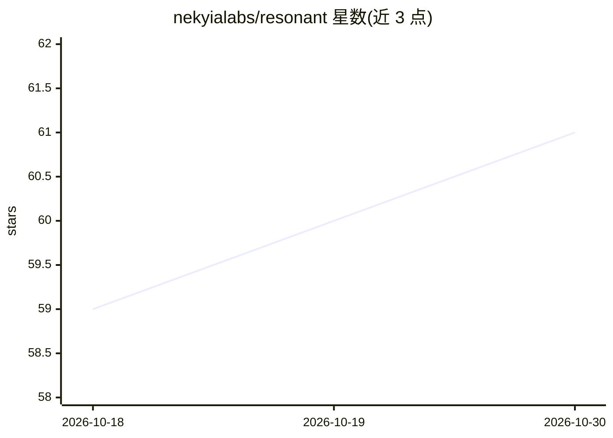

# nekyialabs/resonant

⭐ 61 · TypeScript · Apache-2.0 · 推送 2026-10-11 · [GitHub](https://github.com/nekyialabs/resonant) · [官网](https://liveresonant.com) · 组织维护

**本地自托管的单用户 AI 伴侣应用，带记忆与身份持久化**

基于 Claude Agent SDK 构建的自托管 AI 伴侣 Web 应用：所有对话、记忆与存在状态存储在本地单一 SQLite 文件中；AI 的人格（名字、语气、关系）由用户以纯文本 CLAUDE.md 编写并可热更新。功能包括流式聊天、语义/全文搜索（本地 MiniLM 模型）、主动式编排器（例行问候、提醒、条件触发）、可选的 ElevenLabs/Groq Whisper 语音、Discord/Telegram/Google/MCP 集成与移动 PWA。运行需 Node.js 20-24 与 Claude 凭据（Claude Code 登录或 Anthropic API key），仅支持 Anthropic Claude 模型，非多提供商抽象。通过 git clone 源码安装，npm 构建启动，默认监听 127.0.0.1:3099。

## 筛选速览

| 维度 | 判定 | 备注 |
|---|---|---|
| AI 角色 | `ai-native` | 本体是模型或模型工具 |
| 许可风险 | `permissive` | Apache-2.0 |
| 部署形态 | `library` | 以包/库形式分发 |
| 模型依赖 | locked-api |  |
| 硬件要求 | — | 无带数字的原话,不猜 |
| 安装摩擦 | `low` | 无编译、无系统依赖或容器化 |
| 成熟度 | — | 结构信号不足 |

## 能力要点

- 记忆与身份存储在本地单一 SQLite 文件，人格文件热更新无需重启
- 主动式编排器：例行问候、一次性提醒、条件触发器、失联检查阶梯
- 本地 all-MiniLM-L6-v2 语义搜索 + SQLite FTS5 全文搜索，无外部嵌入服务
- 可选 MCP 工具服务器与 Discord/Telegram/Google 集成（默认关闭）

## 适用场景

- 在自己机器上托管一个记忆持久、人格可自定的 AI 伴侣
- 让 AI 主动发起例行问候、提醒与条件触发的关怀行为
- 通过本地网页与移动 PWA 与 AI 伴侣进行日常对话与日记式记录

## 场景标签

`聊天机器人` `AI 助手` · 领域:对话与助手

## 证据(README 行号)

> L11:  A local-first, single-user AI partner you host yourself — no matter the model. It remembers, keeps a stable identi
> L13:  Not a chat wrapper. A persistent AI partner built as a natural-language harness on the Claude Agent SDK, with hook
> L15: > **Runtime scope:** Resonant is built specifically for Anthropic's Claude models via the Agent SDK's in-process `q

## 星数曲线

2026-10-18 59 → 2026-10-30 61（+2）

---
*卡片 v1 · prompt 1.4 · 生成 2026-10-24 · 置信度 high · 依据 README sha `00a2b59f457c` · [字段定义](../../DATASET.md)*
