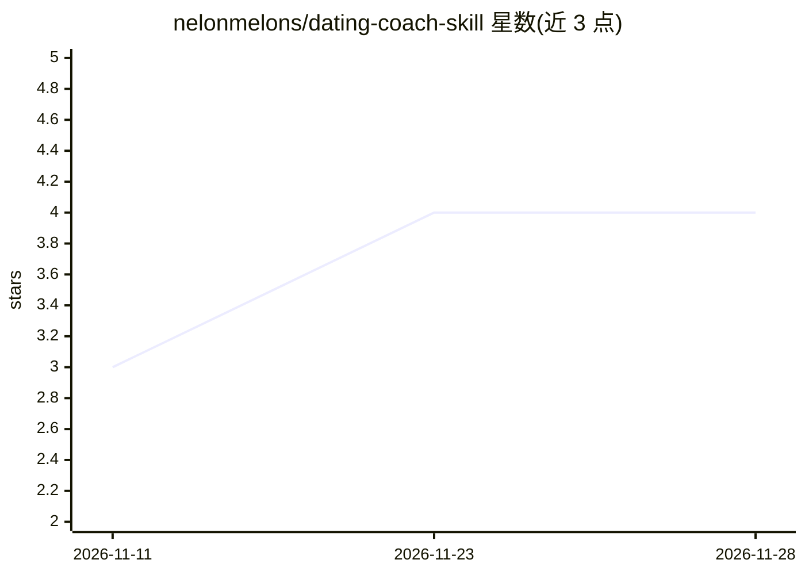

# nelonmelons/dating-coach-skill

⭐ 4 · MIT · 推送 2026-11-10 · [GitHub](https://github.com/nelonmelons/dating-coach-skill) · 个人维护 · 中文 README

**Claude Code 技能：给出可执行的约会建议并附研究依据**

以 Claude Code 技能形式分发的个人约会教练：由 16 小时真实指导录音提炼成方法，对 20 条流行约会说法对照 26 项已发表研究逐条评级，输出统一为判定→计划→可直接粘贴的消息→按回复分支的下一步。内置阶段流水线模型与 6 个规则模型，含 8 个参考文件及中文版本。通过 git clone 安装到技能目录，或在 claude.ai/桌面端上传 zip。作者声明多数研究基于西方样本，默认示例面向男性追求女性。

## 筛选速览

| 维度 | 判定 | 备注 |
|---|---|---|
| AI 角色 | `ai-native` | 本体是模型或模型工具 |
| 许可风险 | `permissive` | MIT |
| 部署形态 | `desktop` | 安装包/桌面程序 |
| 模型依赖 | locked-api |  |
| 硬件要求 | — | 无带数字的原话,不猜 |
| 安装摩擦 | `low` | 无编译、无系统依赖或容器化 |
| 成熟度 | — | 结构信号不足 |

## 能力要点

- 20 条流行说法对照 26 项研究的证据评级表
- 阶段流水线模型定位卡点与回复时机模型
- 输出固定结构：判定→计划→消息脚本→回复分支
- 8 个参考文件并附中文版（references/zh/）

## 适用场景

- 粘贴聊天记录让技能建议下一条消息怎么发
- 让技能规划一场不是吃饭看电影的初次约会
- 查询某条流行约会说法是否有研究支持

## 场景标签

`AI 助手` `AI 写作` · 领域:对话与助手

## 证据(README 行号)

> L5: **A Claude Code skill that tells you exactly what to text, when to ask, and when to let go, with the research behind
> L22: Every answer has the same shape: **verdict → plan → copy-paste messages in your own voice → what to do depending on
> L124: |`SKILL.md`|Coaching workflow, stage model, 15 core principles, non-negotiables, routing|

## 星数曲线

2026-11-11 3 → 2026-11-28 4（+1）

---
*卡片 v1 · prompt 1.4 · 生成 2026-11-21 · 置信度 high · 依据 README sha `5dfd36f37b6f` · [字段定义](../../DATASET.md)*
