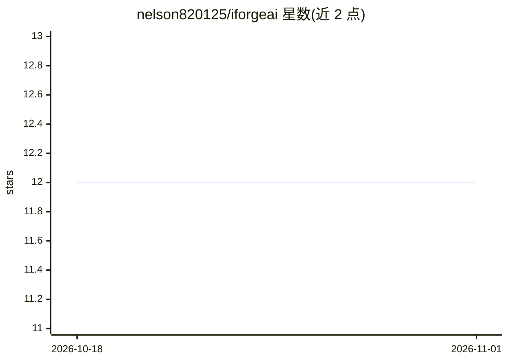

# nelson820125/iforgeai

⭐ 12 · PowerShell · MIT · 推送 2026-09-24 · [GitHub](https://github.com/nelson820125/iforgeai) · 组织维护 · 中文 README

**13 个角色化 AI agent 工具包：组装软件交付团队工作流**

面向软件交付团队的多平台多角色 AI agent 工具包，提供 PM、架构师、DBA、UI 设计师、前端/后端工程师、QA、DevOps 等 13 个专职 agent，各有定义的输入、输出与交接点；协调者 @digital-team 将其串联为带人工门禁评审的顺序工作流。支持 GitHub Copilot、Claude Code、Codex CLI 与 Trae 平台，后端覆盖 .NET/Java/Python。Copilot 路径经 PowerShell 安装器部署，Claude Code/Codex 仅需复制单个配置文件；提供简体中文本地化与 Scrum 模式。

## 筛选速览

| 维度 | 判定 | 备注 |
|---|---|---|
| AI 角色 | `ai-ecosystem` | LLM/agent 周边工具 |
| 许可风险 | `permissive` | MIT |
| 部署形态 | `None` |  |
| 模型依赖 | — | README 未给出锁定关系 |
| 硬件要求 | — | 无带数字的原话,不猜 |
| 安装摩擦 | `medium` | 含编译或系统依赖之一 |
| 成熟度 | — | 结构信号不足 |

## 能力要点

- 13 个专职 agent 组成含门禁评审的顺序交付工作流
- 支持 GitHub Copilot、Claude Code、Codex CLI、Trae 四平台
- DevOps agent 按配置生成 Docker 与 CI/CD 交付物
- 提供简体中文本地化与 Scrum 多版本/迭代模式

## 适用场景

- 在 AI 编码平台中按阶段分工完成需求→架构→开发→测试→部署全流程
- 让 AI 团队为项目生成需求文档、数据库设计与部署指南
- 多迭代项目管理中按版本与冲刺组织 AI 交付产物

## 场景标签

`编码 Agent` `多智能体` · 领域:Agent 开发

## 证据(README 行号)

> L9: A multi-platform, multi-role AI agent toolkit for software delivery teams.
> L16: iforgeAI provides 13 specialist AI agents — one per delivery role. Each agent has defined inputs, outputs, and hand
> L141: > **Copilot Chat (Agent mode):** Switch to Agent mode and select agents from the agent picker — the `@name` above 

## 星数曲线

2026-10-18 12 → 2026-11-01 12（+0）

---
*卡片 v1 · prompt 1.4 · 生成 2026-11-01 · 置信度 high · 依据 README sha `734cc191ed19` · [字段定义](../../DATASET.md)*
