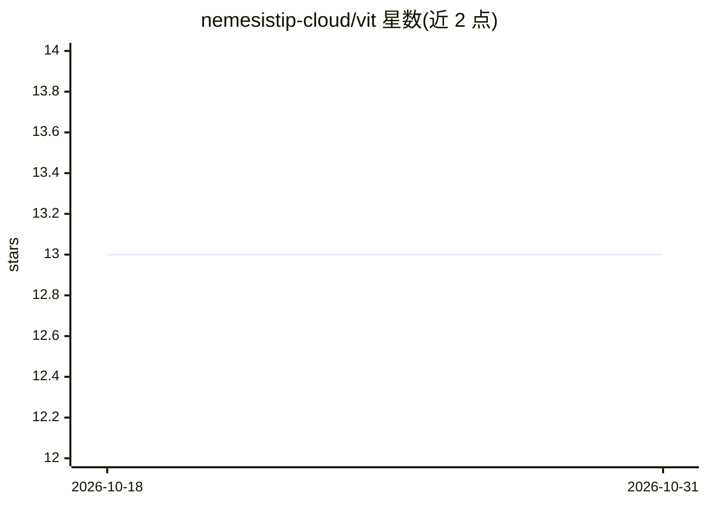

# nemesistip-cloud/vit

⭐ 13 · Python · NOASSERTION · 推送 2026-10-28 · [GitHub](https://github.com/nemesistip-cloud/vit) · [官网](https://vitnetwork-nls4.onrender.com) · 组织维护

**可验证智能服务平台：体育预测、证据溯源与链上结算的一体化 monorepo**

VIT Network 是一个生产级 monorepo，整合实时数据摄取、证据感知的体育赛事预测、自主分析 agent、Tachyon 去中心化存储与 VIT Chain（Chain ID 7764）结算层。预测管线遵循 fail-closed 原则：每条预测需携带来源出处、特征完整性、模型元数据，数据不足时返回 unavailable 及原因。后端基于 FastAPI/PostgreSQL/Redis，前端为 React/Vite 应用，提供 VIT SDK 与社区节点客户端。需从源码克隆运行，生产部署通过 Render 容器化完成。

## 筛选速览

| 维度 | 判定 | 备注 |
|---|---|---|
| AI 角色 | `ai-native` | 本体是模型或模型工具 |
| 许可风险 | `none` | NOASSERTION |
| 部署形态 | `library` | 以包/库形式分发 |
| 模型依赖 | — | README 未给出锁定关系 |
| 硬件要求 | — | 无带数字的原话,不猜 |
| 安装摩擦 | `low` | 无编译、无系统依赖或容器化 |
| 成熟度 | — | 结构信号不足 |

## 能力要点

- 预测管线 fail-closed：无充分证据则返回 unavailable 及原因
- 预测携带证据快照、审计与来源溯源
- 整合 VIT Chain 结算层与 Tachyon 分布式存储
- FastAPI 后端 + React/Vite 前端的 monorepo 结构

## 适用场景

- 运行带证据溯源的体育赛事预测服务
- 参与 VIT 网络的验证与结算生态
- 研究 fail-closed 预测管线的工程实现

## 场景标签

 · 领域:体育智能/区块链服务

## 证据(README 行号)

> L10: VIT Network is a production monorepo for verifiable intelligence services. It combines live data ingestion, evidenc
> L27: - **Intelligence**: live sports data, historical result providers, odds reconciliation, feature engineering, ensemb
> L42: Predictions are not generated merely because an endpoint is available. The pipeline requires sufficient fixture ide

## 星数曲线

2026-10-18 13 → 2026-10-31 13（+0）

---
*卡片 v1 · prompt 1.4 · 生成 2026-10-31 · 置信度 mid · 依据 README sha `2649c5eb09a6` · [字段定义](../../DATASET.md)*
