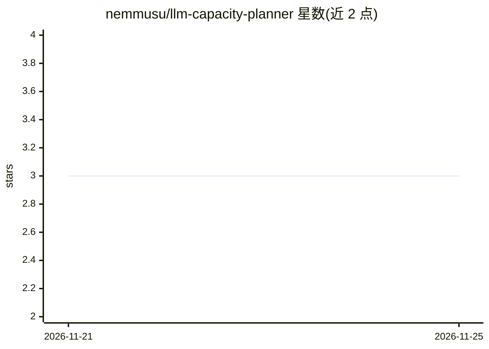

# nemmusu/llm-capacity-planner

⭐ 3 · TypeScript · MIT · 推送 2026-10-15 · [GitHub](https://github.com/nemmusu/llm-capacity-planner) · [官网](https://github.com/nemmusu/llm-capacity-planner) · 个人维护

**为工程师估算 LLM 推理所需 GPU 显存与并发容量的 CLI 计算器**

面向 vLLM 与 SGLang 引擎的 GPU 容量规划命令行工具：输入任意 Hugging Face 模型与负载参数（上下文长度、并发用户、前缀缓存比例），计算权重与 KV cache 显存、匹配 NVIDIA GPU 卡型、估算可服务用户数与每用户 tokens/s。不下载模型、不运行引擎，仅读取 config.json 与 safetensors 头部元数据；速度来自公开基准拟合的 roofline 模型并标注误差区间。提供免依赖单文件可执行程序，也可用 Node.js 22+ 从源码运行，支持 Markdown/CSV/JSON 导出。

## 筛选速览

| 维度 | 判定 | 备注 |
|---|---|---|
| AI 角色 | `ai-ecosystem` | LLM/agent 周边工具 |
| 许可风险 | `permissive` | MIT |
| 部署形态 | `desktop` | 安装包/桌面程序 |
| 模型依赖 | local-ok | 支持本地模型 |
| 硬件要求 | — | 无带数字的原话,不猜 |
| 安装摩擦 | `low` | 无编译、无系统依赖或容器化 |
| 成熟度 | — | 结构信号不足 |

## 能力要点

- 按引擎加载规则逐 tensor 求和权重，KV cache 遵循引擎自身 block 规则
- 速度估计基于 43 个（vLLM）/24 个（SGLang）公开基准拟合，每个数字带误差区间
- 91 个内置目录模型可完全离线使用
- 输出两级：通俗摘要 + 技术明细，可导出 Markdown/CSV/JSON

## 适用场景

- 上线前估算部署某模型需要多少台 GPU 服务器
- 规划 agent 并发工作负载（长上下文、高活跃占比）的硬件规模
- 对比不同 GPU 卡型与配置下的用户容量与生成速度
- 无 GPU 的笔记本上做容量预算与方案文档

## 场景标签

 · 领域:LLM 基础设施/容量规划

## 证据(README 行号)

> L11: **A GPU sizing tool for LLM inference: for any Hugging Face model, it computes the VRAM the model needs on vLLM or 
> L13: It is a VRAM and throughput calculator, not a benchmark. No GPU, no engine, nothing is run (unless you ask it to re
> L74: - **No GPU, no engine, no download.** Reads a few KB of metadata per model (none for the built-in catalog). Runs on

## 星数曲线

2026-11-21 3 → 2026-11-25 3（+0）

---
*卡片 v1 · prompt 1.4 · 生成 2026-11-21 · 置信度 high · 依据 README sha `afb68f71b963` · [字段定义](../../DATASET.md)*
