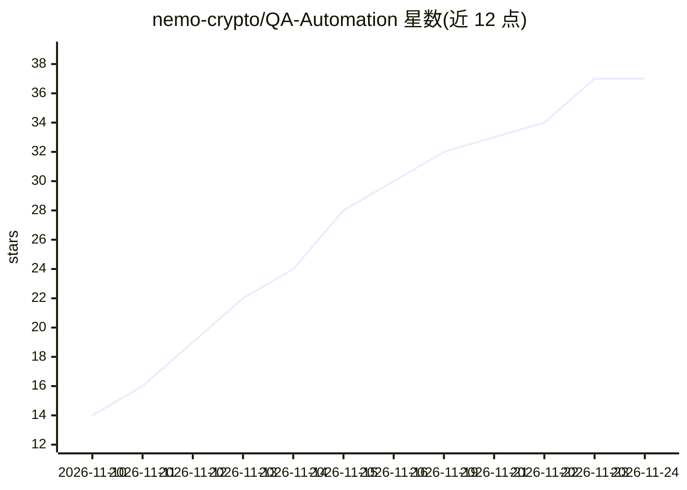

# nemo-crypto/QA-Automation

⭐ 37 · TypeScript · 推送 2026-11-20 · [GitHub](https://github.com/nemo-crypto/QA-Automation) · 个人维护 · 中文 README

**面向测试团队的 Agent+Skill 自动化测试工程基线（Web/API/移动端）**

覆盖 Web UI、HTTP API 与 Android/iOS 的自动化测试工程：以 Playwright 与 Appium 为执行基础，含页面对象、Zod 契约校验、后端业务专项用例与 HTML/JUnit 报告，并提供可直接运行的本地演示服务。AI 部分为 Agent 分阶段协作：通过 tools/agent_runner.py 调用 Codex，按 7 份工程级 Skill 完成测试规划、生成、失败诊断与修复，测试代码独立于模型运行。限制：真实设备流程、真实模型任务及远端 CI 尚未验证，Firefox/WebKit 矩阵等属扩展方向。

## 筛选速览

| 维度 | 判定 | 备注 |
|---|---|---|
| AI 角色 | `ai-enhanced` | 去掉 AI 部分产品仍成立 |
| 许可风险 | `none` | — |
| 部署形态 | `library` | 以包/库形式分发 |
| 模型依赖 | — | README 未给出锁定关系 |
| 硬件要求 | — | 无带数字的原话,不猜 |
| 安装摩擦 | `low` | 无编译、无系统依赖或容器化 |
| 成熟度 | — | 结构信号不足 |

## 能力要点

- Web/API/App 两套工程可分别运行，含本地演示服务与 64 项已验证回归
- agent_runner.py 分阶段调用 Codex，配 7 份工程级 Skill 文件
- GitHub Actions 在 push/PR/手动触发时运行 Web/API 回归与 App 框架检查
- 任务包保存提示词、事件日志与 manifest.json 验证记录

## 适用场景

- 为新项目搭建 UI/API 自动化测试基线
- 让编码 Agent 按规划生成、诊断并修复测试用例
- 团队验证 Agent 辅助测试的协作流程

## 场景标签

`浏览器自动化` `编码 Agent` · 领域:效率与自动化

## 证据(README 行号)

> L31: - **执行可复现**：测试代码独立于模型运行，常规回归通过固定命令执行。
> L55: Agent 角色按阶段调用；常规 CI 执行已提交的测试代码。生成或修复后，调用器使用独立命令验证结果，具体检查范围由工程与参数决定。
> L67: |Agent + Skill|规划、生成、诊断、修复与任务包记录|真实调用需可用的 Codex 登录环境|

## 星数曲线

2026-11-10 14 → 2026-11-24 37（+23）

---
*卡片 v1 · prompt 1.4 · 生成 2026-11-18 · 置信度 high · 依据 README sha `2f8934b47309` · [字段定义](../../DATASET.md)*
