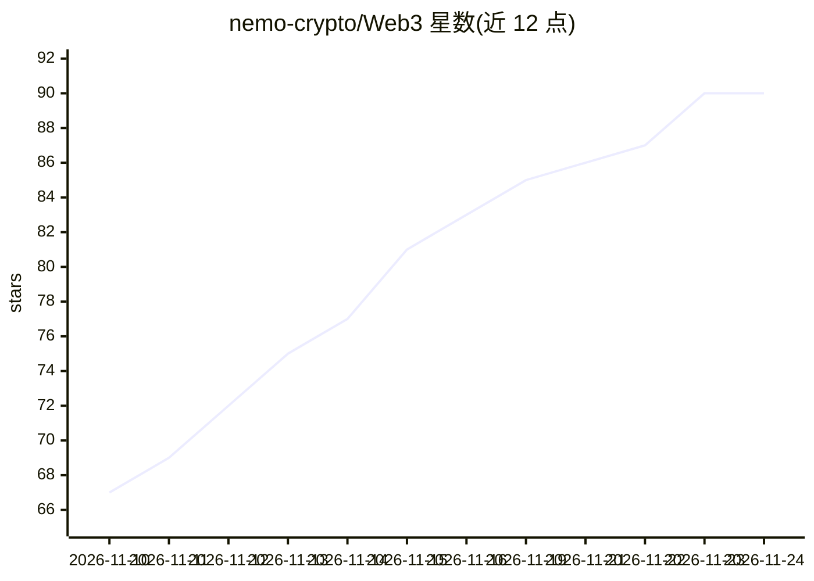

# nemo-crypto/Web3

⭐ 90 · JavaScript · 推送 2026-11-20 · [GitHub](https://github.com/nemo-crypto/Web3) · [官网](https://nemo-crypto.github.io/Web3/) · 个人维护 · 中文 README

**Web3 中文教学手册：系统讲解区块链、DeFi 与量化基础**

面向初学者与开发者的 Web3 中文教程合集：63 篇专题、9 个学习模块，覆盖公链架构、钱包开发（ethers v6、MPC）、DeFi 与 AMM 计算、量化策略与脚本工程、RWA/稳定币及 AI Agent 支付等热点专题。每篇按“是什么、怎样工作、如何计算、易错点”展开并附自测与参考答案，提供按目标选择的学习路线表。文中数字为教学假设，代码示例以离线计算为主，非实盘系统。

## 筛选速览

| 维度 | 判定 | 备注 |
|---|---|---|
| AI 角色 | `ai-knowledge` | 知识聚合/清单类 |
| 许可风险 | `none` | — |
| 部署形态 | `None` |  |
| 模型依赖 | — | README 未给出锁定关系 |
| 硬件要求 | — | 无带数字的原话,不猜 |
| 安装摩擦 | `low` | 无编译、无系统依赖或容器化 |
| 成熟度 | — | 结构信号不足 |

## 能力要点

- 63 篇专题、9 个学习模块的中文教程体系
- 提供按目标（理解/开发/交易/量化）的学习路线与学后自测
- 覆盖 ERC-8004、x402、zkTLS、EIP-7702 等智能体与支付新协议专题
- 每篇附自测、参考答案与资料核验记录

## 适用场景

- 从零系统学习 Web3 与区块链基础概念
- 开发 DApp 时查阅钱包接入、SDK 与 GraphQL 的实现边界
- 学习 DeFi 报价计算与量化策略的工程实践
- 了解 AI Agent 支付与账户抽象等新协议机制

## 场景标签

`教程课程` `金融量化` · 领域:学习与行业

## 证据(README 行号)

> L5: > **63 篇专题 · 9 个学习模块 · 中文教学版**
> L15: Web3 中文教学手册：Ethereum、钱包开发、Ethers.js、DeFi、AMM、Layer 2、跨链桥与量化策略基础。Blockchain and DApp tutorials with learning paths a

## 星数曲线

2026-11-10 67 → 2026-11-24 90（+23）

---
*卡片 v1 · prompt 1.4 · 生成 2026-11-18 · 置信度 high · 依据 README sha `8a77f2c2db29` · [字段定义](../../DATASET.md)*
