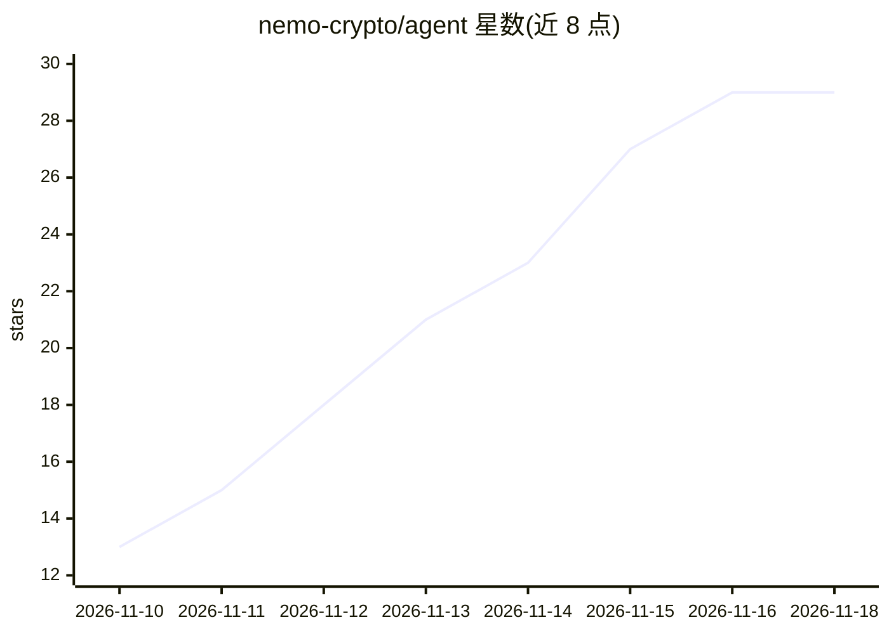

# nemo-crypto/agent

⭐ 29 · Go · 推送 2026-11-13 · [GitHub](https://github.com/nemo-crypto/agent) · 个人维护 · 中文 README

**契约驱动的 AI 全栈开发实践工程与 Agent 工作流**

基于 Next.js、Go 和 OpenAPI 的全栈开发实践工程：开发者用 Markdown 描述需求，Agent 按架构设计、契约、后端、前端、验收等阶段串行推进，以类型检查、Go 测试、生产构建和 Playwright 联调作为质量门禁；业务侧为任务看板（JSON 文件持久化），运行不依赖模型服务。AI 编排通过本机 Codex CLI 执行，需开发者已登录并提供模型额度。定位为单进程本地开发与 AI 工程实践基线，真实模型链路与 Docker 构建尚未执行，认证、多租户、生产部署需自行补充。

## 筛选速览

| 维度 | 判定 | 备注 |
|---|---|---|
| AI 角色 | `ai-ecosystem` | LLM/agent 周边工具 |
| 许可风险 | `none` | — |
| 部署形态 | `None` |  |
| 模型依赖 | — | README 未给出锁定关系 |
| 硬件要求 | — | 无带数字的原话,不猜 |
| 安装摩擦 | `low` | 无编译、无系统依赖或容器化 |
| 成熟度 | `idea` | |

## 能力要点

- OpenAPI 契约驱动：自动生成 Go 服务端接口与 TypeScript 类型并检测漂移
- 分阶段 Agent 工作流（设计/契约/后端/前端/验收/只读审查），失败或超时即停止
- 4 个 Skill、5 个 Agent 角色与结构化输出协议
- 自动化质量门禁：契约检查、ESLint、go vet、race 测试、Next.js 构建、Playwright

## 适用场景

- 学习契约驱动的前后端全栈 AI 开发流程
- 建立团队的 AI 开发规范与阶段化验收基线
- 在本地验证业务原型并跟踪 Agent 执行日志

## 场景标签

`编码 Agent` `工作流自动化` · 领域:效率与自动化

## 证据(README 行号)

> L5: 本项目将需求设计、接口契约、前后端实现和自动化验收组织为一套可执行的 Agent 工作流。开发者通过 Markdown 描述需求，Agent 按职责推进实现，并以类型检查、后端测试、生产构建和浏览器联调结果作为交付依据。
> L24: - **分阶段 AI 开发**：需求设计、API 契约、后端、前端、自动验收和只读审查分别承担明确职责。
> L31: 业务运行与 AI 开发相互独立：任务看板可直接启动，业务请求不依赖模型服务；开发工作流在开发者显式执行后调用本机 Codex CLI。

## 星数曲线

2026-11-10 13 → 2026-11-18 29（+16）

---
*卡片 v1 · prompt 1.4 · 生成 2026-11-18 · 置信度 high · 依据 README sha `0a0aedf3c205` · [字段定义](../../DATASET.md)*
