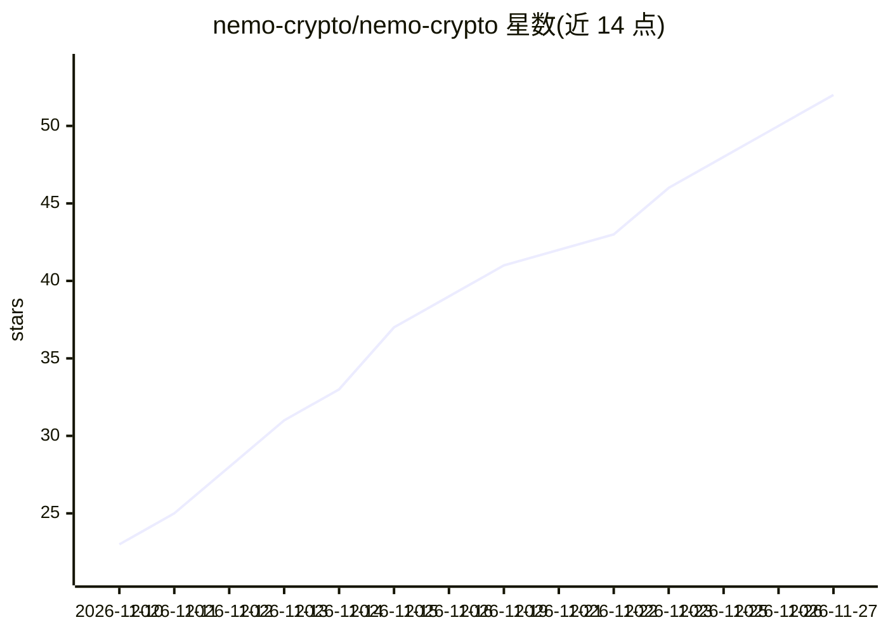

# nemo-crypto/nemo-crypto

⭐ 52 · 推送 2026-11-16 · [GitHub](https://github.com/nemo-crypto/nemo-crypto) · 个人维护 · 中文 README

**全栈/Web3 开发者的 GitHub 个人主页与项目入口**

个人开发者 portfolio 仓库：以 README 形式展示作者在全栈 Web、跨平台/迷你应用、链上数据与行情系统、Web3 预测市场方向的实践，列出 monorepo、Express API、QA 自动化等项目与技术栈（TypeScript、Go、Rust、React/Next.js、Flutter 等）。另设 AI Agents 与自动化板块，提及使用 LangChain/LangGraph、Mastra、n8n 构建代理工作流的探索方向。仓库本身为展示型主页，不提供可安装运行的产品。

## 筛选速览

| 维度 | 判定 | 备注 |
|---|---|---|
| AI 角色 | `ai-enhanced` | 去掉 AI 部分产品仍成立 |
| 许可风险 | `none` | — |
| 部署形态 | `None` |  |
| 模型依赖 | — | README 未给出锁定关系 |
| 硬件要求 | — | 无带数字的原话,不猜 |
| 安装摩擦 | `low` | 无编译、无系统依赖或容器化 |
| 成熟度 | — | 结构信号不足 |

## 能力要点

- 展示全栈/移动/链上数据/行情系统五个方向的工程实践
- 技术栈覆盖 TypeScript、Go、Rust、React/Next.js、Flutter、React Native
- AI 板块提及 LangChain/LangGraph、Mastra、n8n 代理工作流探索

## 适用场景

- 了解该开发者的技能方向与项目入口
- 作为 GitHub 个人主页模板参考

## 场景标签

 · 领域:开发者展示/个人品牌

## 证据(README 行号)

> L12:  Full-Stack Developer · Web3 Builder · Professional Debugger 🐛
> L87: ## 🤖 AI Agents & Automation

## 星数曲线

2026-11-10 23 → 2026-11-27 52（+29）

---
*卡片 v1 · prompt 1.4 · 生成 2026-11-18 · 置信度 mid · 依据 README sha `ce61ed13415a` · [字段定义](../../DATASET.md)*
