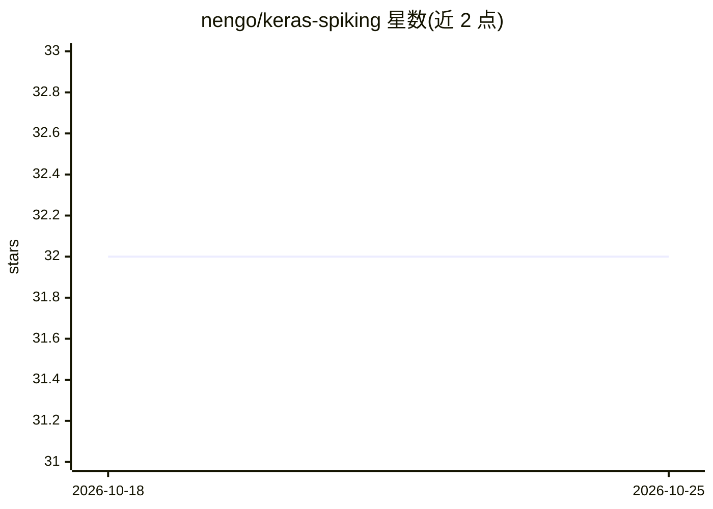

# nengo/keras-spiking

⭐ 32 · Python · NOASSERTION · 推送 2026-08-02 · [GitHub](https://github.com/nengo/keras-spiking) · [官网](https://www.nengo.ai/keras-spiking/) · 组织维护

**在 Keras 中训练与运行脉冲神经网络的工具库**

面向使用 Keras/TensorFlow 的深度学习开发者，提供将任意激活函数转换为脉冲等价形式的 SpikingActivation 层，使非脉冲模型可改写为脉冲模型；采用'spiking aware training'机制：前向传播用脉冲激活，反向传播用可微的非脉冲激活函数。附带用于脉冲模型训练的正则化器与滤波层等辅助工具。模型优化与评估方式与普通 Keras 模型一致。以 Python 包形式经 PyPI 分发，安装说明见其文档站。

## 筛选速览

| 维度 | 判定 | 备注 |
|---|---|---|
| AI 角色 | `ai-ecosystem` | LLM/agent 周边工具 |
| 许可风险 | `none` | NOASSERTION |
| 部署形态 | `library` | 以包/库形式分发 |
| 模型依赖 | — | README 未给出锁定关系 |
| 硬件要求 | — | 无带数字的原话,不猜 |
| 安装摩擦 | `low` | 无编译、无系统依赖或容器化 |
| 成熟度 | — | 结构信号不足 |

## 能力要点

- SpikingActivation 可将任意激活函数转换为脉冲等价形式
- spiking aware training：前向脉冲激活、反向可微激活
- 附带脉冲模型训练用正则化器与滤波层
- 转换后的模型按普通 Keras 模型方式优化与评估

## 适用场景

- 把现有非脉冲 Keras 模型改写为脉冲神经网络
- 在 Keras 工作流中直接训练脉冲模型
- 用正则化器与滤波层辅助脉冲模型的优化

## 场景标签

`模型训练` · 领域:训练与推理

## 证据(README 行号)

> L11: KerasSpiking provides tools for training and running spiking neural networks
> L35: Models with SpikingActivation layers can be optimized and evaluated in the same way as

## 星数曲线

2026-10-18 32 → 2026-10-25 32（+0）

---
*卡片 v1 · prompt 1.4 · 生成 2026-10-25 · 置信度 high · 依据 README sha `8eb5d03c07a7` · [字段定义](../../DATASET.md)*
