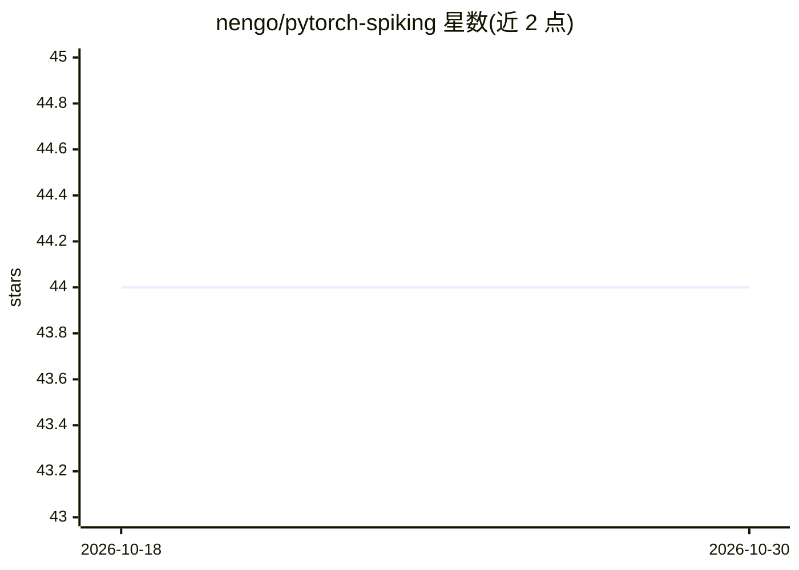

# nengo/pytorch-spiking

⭐ 44 · Python · NOASSERTION · 推送 2026-08-02 · [GitHub](https://github.com/nengo/pytorch-spiking) · [官网](https://www.nengo.ai/pytorch-spiking/) · 组织维护

**PyTorch 脉冲神经网络训练与运行库**

PyTorchSpiking 提供 SpikingActivation 等工具，将任意激活函数转换为脉冲等价形式，使非脉冲模型改写为脉冲神经网络；模型可用常规 PyTorch 方式优化与评估。关键机制为 spiking aware training：前向传播用脉冲激活，反向传播用可微的非脉冲激活。另含 filtering layers 等训练辅助模块，文档中另提供与 NengoDL 的用途对比。面向使用 PyTorch 构建脉冲神经网络的开发者。

## 筛选速览

| 维度 | 判定 | 备注 |
|---|---|---|
| AI 角色 | `ai-native` | 本体是模型或模型工具 |
| 许可风险 | `none` | NOASSERTION |
| 部署形态 | `library` | 以包/库形式分发 |
| 模型依赖 | — | README 未给出锁定关系 |
| 硬件要求 | — | 无带数字的原话,不猜 |
| 安装摩擦 | `low` | 无编译、无系统依赖或容器化 |
| 成熟度 | — | 结构信号不足 |

## 能力要点

- SpikingActivation 可将任意激活函数转为脉冲等价形式
- spiking aware training：前向用脉冲激活、反向用可微激活
- 包含 filtering layers 等训练辅助工具
- 模型沿用常规 PyTorch 优化与评估方式

## 适用场景

- 把已有 PyTorch 非脉冲模型改写为脉冲神经网络
- 在 PyTorch 内训练和运行脉冲神经元模型
- 需要可微分替代激活以训练脉冲网络的研究工作

## 场景标签

`模型训练` · 领域:训练与推理

## 证据(README 行号)

> L11: PyTorchSpiking provides tools for training and running spiking neural networks
> L13: ``pytorch_spiking.SpikingActivation``, which can be used to transform

## 星数曲线

2026-10-18 44 → 2026-10-30 44（+0）

---
*卡片 v1 · prompt 1.4 · 生成 2026-10-25 · 置信度 high · 依据 README sha `6501fab5bfda` · [字段定义](../../DATASET.md)*
