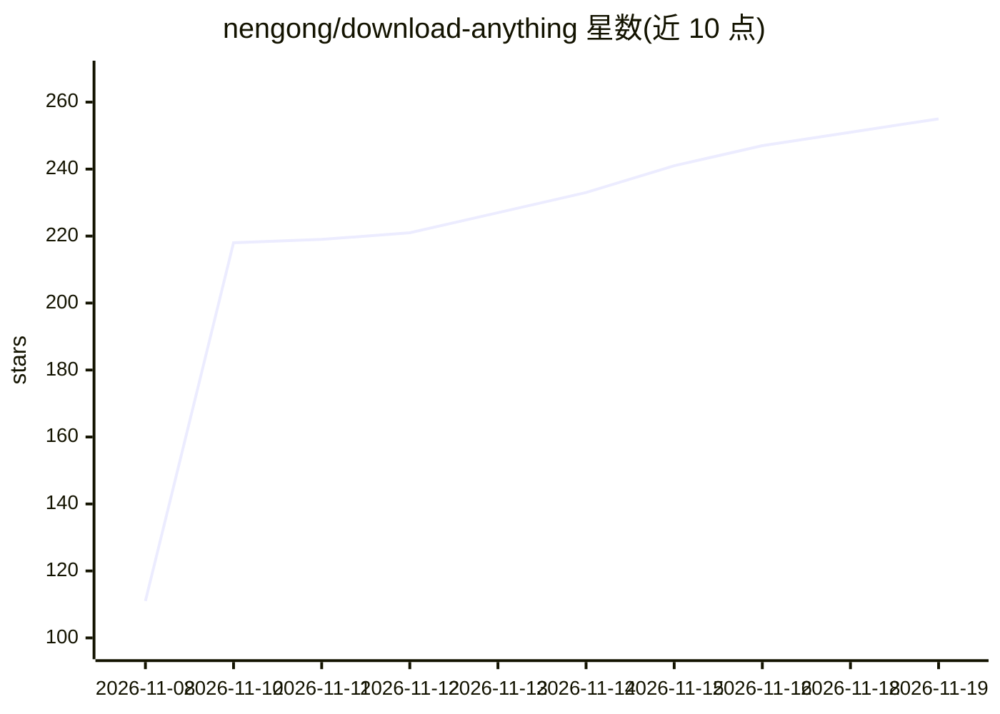

# nengong/download-anything

⭐ 255 · Python · 推送 2026-11-08 · [GitHub](https://github.com/nengong/download-anything) · [官网](https://github.com/nengong/download-anything#readme) · 个人维护 · 中文 README

**个人与 AI Agent 用的全能下载与结构化归档 CLI**

提供命令行 CLI 与 Agent Skill 双入口的下载工具：输入链接、DOI、ISBN、App 分享口令或包名，下载视频、图文、播客、文章、论文、电子书、网盘文件、字体与安装包等，并同步落盘字幕、封面、BibTeX、本地化 Markdown 等附件。机制上包含口令净化、按内容类型匹配驱动、基于 ffprobe/pypdf/Pillow 的完整性校验与 Obsidian 知识库同步。要求 Python 3.10+，音视频功能依赖 FFmpeg，通过 install.py 装入独立虚拟环境，支持凭据注入与无头运行。

## 筛选速览

| 维度 | 判定 | 备注 |
|---|---|---|
| AI 角色 | `ai-enhanced` | 去掉 AI 部分产品仍成立 |
| 许可风险 | `permissive` | — |
| 部署形态 | `desktop` | 安装包/桌面程序 |
| 模型依赖 | — | README 未给出锁定关系 |
| 硬件要求 | — | 无带数字的原话,不猜 |
| 安装摩擦 | `medium` | 含编译或系统依赖之一 |
| 成熟度 | — | 结构信号不足 |

## 能力要点

- 从分享口令/脏链接提取 URL、提取码、DOI、ISBN 与 MD5
- 多格式完整性校验（ffprobe 音视频双轨、pypdf/EPUB/ZIP 结构检查）
- 结构化归档：.srt 字幕、citation.bib、本地化 Markdown，可同步 Obsidian
- 覆盖 B站/抖音/小红书/YouTube、网盘、学术、字体、APK/微软商店离线包等多源

## 适用场景

- 把社交平台分享口令或论文 DOI 交给 CLI 一键下载并归档
- 作为 Claude Code 等 Agent 的 Skill，让 Agent 代为下载与整理资料
- 将文章与播客内容转成 Markdown 同步进 Obsidian 知识库

## 场景标签

`网页抓取` `知识库管理` · 领域:效率与自动化

## 证据(README 行号)

> L17: > **All-in-one downloader CLI & AI Agent Skill** for videos, articles, podcasts, academic papers, books, cloud-driv
> L29: 把这句话发给 Claude Code、Codex 等 Agent：

## 星数曲线

2026-11-08 111 → 2026-11-19 255（+144）

---
*卡片 v1 · prompt 1.4 · 生成 2026-11-17 · 置信度 mid · 依据 README sha `d8b0caf32783` · [字段定义](../../DATASET.md)*
