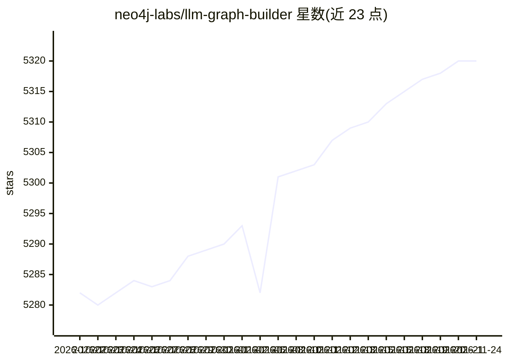

# neo4j-labs/llm-graph-builder

⭐ 5,322 · Jupyter Notebook · Apache-2.0 · 推送 2026-11-01 · [GitHub](https://github.com/neo4j-labs/llm-graph-builder) · [官网](https://llm-graph-builder.neo4jlabs.com/) · 组织维护

**用 LLM 把非结构化数据构建为 Neo4j 知识图谱的应用**

基于 FastAPI 后端与 React 前端的应用：从本机、GCS、S3、YouTube、Wikipedia、网页等来源上传 PDF/DOC/TXT 等文件，调用所选 LLM 抽取节点、关系及属性，存入 Neo4j 5.23+ 数据库（需 APOC，支持 Aura 与 Desktop 部署形态）。支持自定义或预置 schema、Neo4j Bloom 可视化、面向已处理数据的对话问答及多种检索模式（vector/graph/fulltext 等），并提供按用户与数据库的 token 用量跟踪与嵌入模型选择。本项目为实验性 Neo4j Labs 项目，不属于 Neo4j 官方支持产品线。

## 筛选速览

| 维度 | 判定 | 备注 |
|---|---|---|
| AI 角色 | `ai-native` | 本体是模型或模型工具 |
| 许可风险 | `permissive` | Apache-2.0 |
| 部署形态 | `self-host` | docker 或自建部署 |
| 模型依赖 | local-ok | 支持本地模型 |
| 硬件要求 | — | 无带数字的原话,不猜 |
| 安装摩擦 | `low` | 无编译、无系统依赖或容器化 |
| 成熟度 | `idea` | |

## 能力要点

- 支持 11 类 LLM 来源（OpenAI、Gemini、Diffbot、Bedrock、Ollama 等），含 OpenAI 兼容 base URL
- 可配置 schema 的实体/关系抽取，生成结构化知识图谱
- 7 种聊天检索模式与 Neo4j Bloom 图可视化
- token 用量跟踪与嵌入模型（OpenAI/Gemini/Titan/Sentence Transformers）配置

## 适用场景

- 把一批 PDF/网页/YouTube 视频抽取为 Neo4j 知识图谱
- 对已入库文档做图谱+向量混合检索问答
- 用本地 Ollama 模型离线做图谱抽取

## 场景标签

`知识图谱` `RAG` `文档解析` · 领域:知识与检索

## 证据(README 行号)

> L8: Transform unstructured data (PDFs, DOCs, TXTs, YouTube videos, web pages, etc.) into a structured Knowledge Graph st
> L10: This application allows you to upload files from various sources (local machine, GCS, S3 bucket, or web sources), c
> L42: - Seamlessly transform unstructured data into structured Knowledge Graphs using advanced LLMs.

## 星数曲线

2026-10-22 5,282 → 2026-11-24 5,320（+38）

---
*卡片 v1 · prompt 1.4 · 生成 2026-11-22 · 置信度 high · 依据 README sha `99d133f75d95` · [字段定义](../../DATASET.md)*
