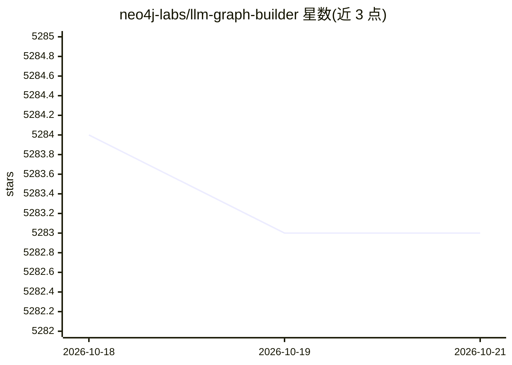

# neo4j-labs/llm-graph-builder

⭐ 5,283 · Jupyter Notebook · Apache-2.0 · 推送 2026-10-17 · [GitHub](https://github.com/neo4j-labs/llm-graph-builder) · [官网](https://llm-graph-builder.neo4jlabs.com/) · 组织维护

**用 LLM 把非结构化数据转为 Neo4j 知识图谱的应用**

Neo4j Labs 开发的全栈应用（FastAPI 后端 + React 前端）：上传本地文件、S3/GCS、YouTube、网页、维基百科等非结构化数据，调用 LLM 抽取实体、关系与属性生成知识图谱，存入 Neo4j 5.23+（需 APOC）。支持自定义 schema、Neo4j Bloom 图可视化、7 种检索模式的多轮对话问答（含 /chat-only 独立聊天界面）、按用户与数据库的 token 用量跟踪，以及 OpenAI/Gemini/Diffbot/Anthropic/Ollama 等 11 类模型接入。提供 docker-compose 本地部署与 GCP Cloud Run 云部署两种方式；Neo4j Desktop 场景下前后端需分别部署。

## 筛选速览

| 维度 | 判定 | 备注 |
|---|---|---|
| AI 角色 | `ai-native` | 本体是模型或模型工具 |
| 许可风险 | `permissive` | Apache-2.0 |
| 部署形态 | `self-host` | docker 或自建部署 |
| 模型依赖 | local-ok | 支持本地模型 |
| 硬件要求 | — | 无带数字的原话,不猜 |
| 安装摩擦 | `low` | 无编译、无系统依赖或容器化 |
| 成熟度 | — | 结构信号不足 |

## 能力要点

- 多源输入（本地/S3/GCS/YouTube/网页/维基百科）抽取实体与关系生成图谱
- 支持 11 类 LLM（OpenAI/Gemini/Diffbot/Anthropic/Ollama/Deepseek 等）
- 7 种聊天检索模式（vector/graph/fulltext 及其组合）
- 按用户与数据库连接的 token 用量跟踪与限额 API

## 适用场景

- 把 PDF、网页、YouTube 视频等资料转成知识图谱供检索问答
- 在 Neo4j 上构建 GraphRAG 问答系统并可视化图谱
- 用本地 Ollama 模型离线完成实体关系抽取

## 场景标签

`知识图谱` `RAG` `文档问答` · 领域:知识与检索

## 证据(README 行号)

> L6: Transform unstructured data (PDFs, DOCs, TXTs, YouTube videos, web pages, etc.) into a structured Knowledge Graph st
> L40: - Seamlessly transform unstructured data into structured Knowledge Graphs using advanced LLMs.
> L50: - Interact with your data in the Neo4j database through conversational queries.

## 星数曲线

2026-10-18 5,284 → 2026-10-21 5,283（-1）

---
*卡片 v1 · prompt 1.4 · 生成 2026-10-20 · 置信度 high · 依据 README sha `9db324d791a4` · [字段定义](../../DATASET.md)*
