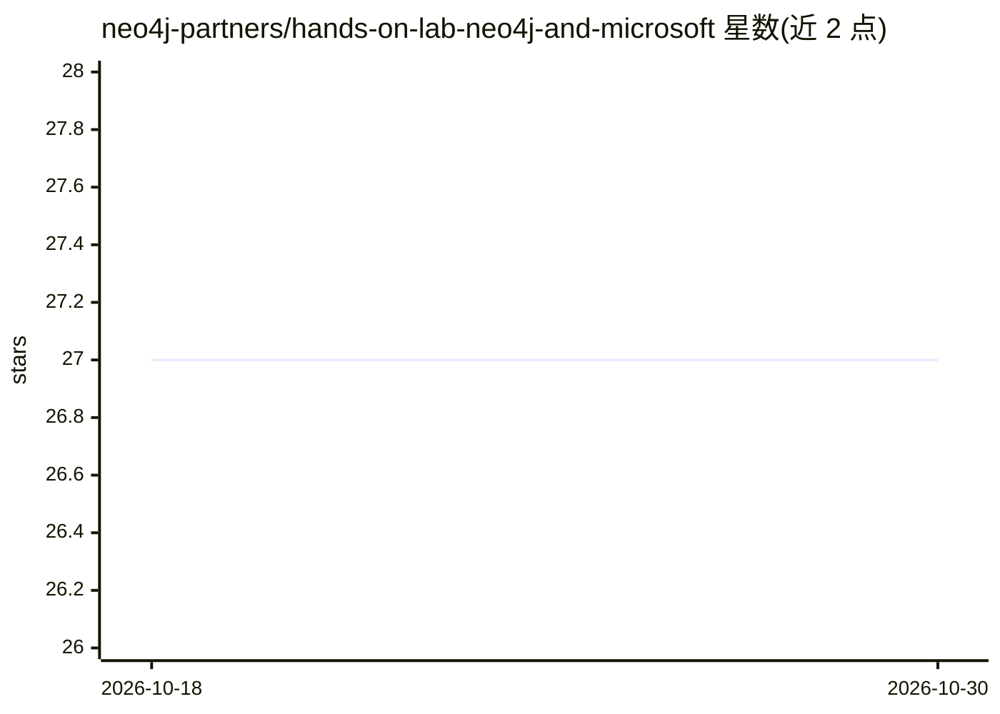

# neo4j-partners/hands-on-lab-neo4j-and-microsoft

⭐ 27 · Apache-2.0 · 推送 2026-10-02 · [GitHub](https://github.com/neo4j-partners/hands-on-lab-neo4j-and-microsoft) · 组织维护

**Neo4j 与 Microsoft Foundry 结合图 AI 的实操工作坊教程**

由 Neo4j 团队组织的 3 小时线下实操实验室，面向数据科学家与数据工程师，讲授如何在 Azure 上部署 Neo4j Aura 与 Microsoft Foundry，并用 AI 解析加载 SEC EDGAR 资产管理机构季度申报数据，构建知识图谱、探索 Cypher 查询，再在其上叠加 AI agent 与 RAG 流程。学员需自带可访问 Azure Portal 与 Neo4j Aura Console 的浏览器笔记本，工作坊在 Microsoft 办公室现场进行。

## 筛选速览

| 维度 | 判定 | 备注 |
|---|---|---|
| AI 角色 | `ai-knowledge` | 知识聚合/清单类 |
| 许可风险 | `permissive` | Apache-2.0 |
| 部署形态 | `None` |  |
| 模型依赖 | — | README 未给出锁定关系 |
| 硬件要求 | — | 无带数字的原话,不猜 |
| 安装摩擦 | `low` | 无编译、无系统依赖或容器化 |
| 成熟度 | — | 结构信号不足 |

## 能力要点

- Azure 上部署 Neo4j Aura 与 Microsoft Foundry 的分步实验（9 个 Lab）
- 以 SEC EDGAR 1 亿美元以上 AUM 机构申报为真实数据集
- 覆盖知识图谱生成、RAG 与 AI agent 叠加于图谱的流程

## 适用场景

- 学习在 Azure 中部署 Neo4j 并与 Foundry 集成
- 用 AI 解析监管申报数据并构建知识图谱
- 了解资本市场场景下图 AI 与 agentic pipeline 的应用

## 场景标签

`知识图谱` `RAG` `教程课程` · 领域:知识与检索

## 证据(README 行号)

> L5: In this hands on lab, you’ll get to learn about Neo4j and Microsoft Foundry. The lab is intended for data scientists
> L9: If you’re in the capital markets space, we think you’ll be interested in potential applications of this approach to 

## 星数曲线

2026-10-18 27 → 2026-10-30 27（+0）

---
*卡片 v1 · prompt 1.4 · 生成 2026-10-26 · 置信度 high · 依据 README sha `a237946e0eee` · [字段定义](../../DATASET.md)*
