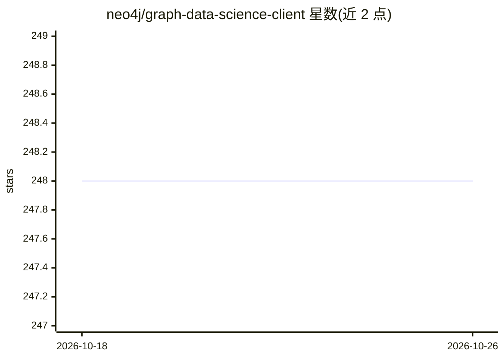

# neo4j/graph-data-science-client

⭐ 248 · Python · Apache-2.0 · 推送 2026-10-23 · [GitHub](https://github.com/neo4j/graph-data-science-client) · [官网](https://neo4j.com/product/graph-data-science/) · 组织维护

**Neo4j 图数据科学库的 Python 客户端：Python 代码操作图算法**

Neo4j 官方提供的 graphdatascience Python 客户端，让用户以纯 Python 代码投影图、运行图算法、定义和使用 GDS 中的机器学习流水线。API 模仿 GDS Cypher 过程调用，封装 Neo4j Python driver，并提供 graph、model、pipeline 对象减少 Cypher 使用。支持两种连接方式：Aura Graph Analytics 的 GDS Sessions（凭 Aura API key），或自管 Neo4j 加 GDS 插件直连。仅保证兼容 GDS 2.0+；数值工具函数明确不支持。附 Jupyter 端到端示例（节点分类、FastRP+kNN 推荐等）。

## 筛选速览

| 维度 | 判定 | 备注 |
|---|---|---|
| AI 角色 | `ai-ecosystem` | LLM/agent 周边工具 |
| 许可风险 | `permissive` | Apache-2.0 |
| 部署形态 | `library` | 以包/库形式分发 |
| 模型依赖 | — | README 未给出锁定关系 |
| 硬件要求 | — | 无带数字的原话,不猜 |
| 安装摩擦 | `low` | 无编译、无系统依赖或容器化 |
| 成熟度 | — | 结构信号不足 |

## 能力要点

- 纯 Python 投影图、运行算法、定义 ML 流水线
- API 模仿 GDS Cypher 过程，封装 Neo4j Python driver
- 支持 GDS Sessions（Aura）与自管 Neo4j+GDS 插件两种连接
- 附带 Jupyter 端到端示例（节点分类、kNN 推荐、HashGNN 等）

## 适用场景

- 用 Python 脚本调用 GDS 图算法与图机器学习流水线
- 在 Jupyter 中做节点分类、推荐等图分析实验
- 为 Aura Graph Analytics 或自管 Neo4j 部署编写图数据科学工作流

## 场景标签

`知识图谱` · 领域:知识与检索

## 证据(README 行号)

> L11: `graphdatascience` is a Python client for operating and working with the Neo4j Graph Data Science (GDS) library.
> L12: It enables users to write pure Python code to project graphs, run algorithms, as well as define and use machine lea

## 星数曲线

2026-10-18 248 → 2026-10-26 248（+0）

---
*卡片 v1 · prompt 1.4 · 生成 2026-10-22 · 置信度 high · 依据 README sha `cc7571764f5c` · [字段定义](../../DATASET.md)*
