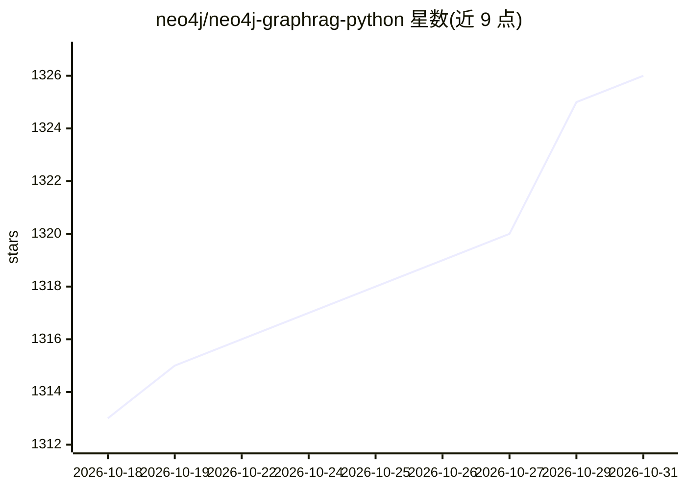

# neo4j/neo4j-graphrag-python

⭐ 1,326 · Python · NOASSERTION · 推送 2026-10-30 · [GitHub](https://github.com/neo4j/neo4j-graphrag-python) · [官网](https://neo4j.com/docs/neo4j-graphrag-python/current/) · 组织维护

**Neo4j 官方 Python 库：构建 GraphRAG 应用与知识图谱**

Neo4j 第一方 Python 包，供开发者在 Neo4j 图数据库之上构建图检索增强生成（GraphRAG）应用。提供知识图谱构建（Pipeline 与 SimpleKGPipeline，支持文本与 PDF）、向量索引创建与填充、多种检索器（向量、混合、Text2Cypher）及 RAG 生成组件；LLM 提供方（Ollama/OpenAI/Anthropic 等）与向量库（Weaviate/Pinecone/Qdrant）以 pip extras 可选接入。运行需 Neo4j 实例；KG 构建功能要求 Neo4j 安装 APOC core。实验命名空间特性不推荐生产使用。支持 Python 3.10-3.14（nlp extra 暂不支持 3.14）。

## 筛选速览

| 维度 | 判定 | 备注 |
|---|---|---|
| AI 角色 | `ai-ecosystem` | LLM/agent 周边工具 |
| 许可风险 | `none` | NOASSERTION |
| 部署形态 | `self-host` | docker 或自建部署 |
| 模型依赖 | local-ok | 支持本地模型 |
| 硬件要求 | — | 无带数字的原话,不猜 |
| 安装摩擦 | `low` | 无编译、无系统依赖或容器化 |
| 成熟度 | — | 结构信号不足 |

## 能力要点

- Pipeline 与 SimpleKGPipeline 两种知识图谱构建路径，支持文本与 PDF
- 向量索引创建/填充与多种检索器（向量、混合、Text2Cypher）
- 9 家 LLM 提供方与 3 种外部向量库经 pip extras 可选接入
- 同时发布于 PyPI 与 conda-forge

## 适用场景

- 在 Neo4j 上从文档构建知识图谱并做 GraphRAG 问答
- 为已填充的图数据配置向量/混合检索
- 用 Text2Cypher 等检索器接入自有 LLM 构建 RAG 管线

## 场景标签

`知识图谱` `RAG` · 领域:知识与检索

## 证据(README 行号)

> L3: The official Neo4j GraphRAG package for Python enables developers to build graph retrieval augmented generation (Gra
> L61: - LLM providers (at least one is required for RAG and KG Builder Pipeline):

## 星数曲线

2026-10-18 1,313 → 2026-10-31 1,326（+13）

---
*卡片 v1 · prompt 1.4 · 生成 2026-10-21 · 置信度 mid · 依据 README sha `e14cf57ca7aa` · [字段定义](../../DATASET.md)*
