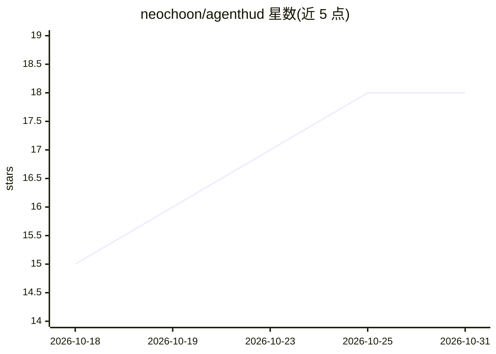

# neochoon/agenthud

⭐ 18 · TypeScript · 推送 2026-10-30 · [GitHub](https://github.com/neochoon/agenthud) · [官网](https://www.npmjs.com/package/agenthud) · 个人维护

**AI 编码 agent 的 TUI 监控面板：实时查看多 agent 会话与子 agent**

读取 Claude Code、OpenAI Codex、AWS Kiro、opencode 各 agent 在磁盘上的会话文件（JSONL 或 SQLite），合并为按项目组织的单一树状视图。分三层：实时 TUI HUD 显示每个会话/子 agent 的 working/waiting 状态与活动流；summary 命令把一天/一周的会话通过本机已装的 agent CLI 生成工程摘要；report 输出结构化 Markdown/JSON，follow 输出 NDJSON 事件流供上层监督程序消费。需 Node.js 20+（opencode 会话需 22+），主要在 macOS/Linux 开发，Windows 有 CI 测试。

## 筛选速览

| 维度 | 判定 | 备注 |
|---|---|---|
| AI 角色 | `ai-ecosystem` | LLM/agent 周边工具 |
| 许可风险 | `none` | — |
| 部署形态 | `library` | 以包/库形式分发 |
| 模型依赖 | locked-api |  |
| 硬件要求 | — | 无带数字的原话,不猜 |
| 安装摩擦 | `low` | 无编译、无系统依赖或容器化 |
| 成熟度 | — | 结构信号不足 |

## 能力要点

- 合并 4 种编码 agent 的会话为统一项目树
- 实时 TUI：会话 working/waiting 状态与子 agent 活动流
- summary 经本机 agent CLI（claude/codex/kiro 自动探测）生成每日摘要
- report/follow 输出 Markdown/JSON/NDJSON 供脚本与管道消费

## 适用场景

- 在侧边终端同时监控多个并行运行的编码 agent 会话
- 一天结束时生成跨 agent 的工程进展摘要
- 把会话事件流接入自己的 dashboard 或上层监督程序

## 场景标签

`LLM 可观测性` · 领域:评测与运维

## 证据(README 行号)

> L7: A **heads-up display** for your AI coding agents — **Claude Code**, **OpenAI Codex**, **AWS Kiro**, and **opencode**
> L15: - **`agenthud report`** — **the machine layer.** Structured Markdown / JSON. `summary` is literally `report` piped 

## 星数曲线

2026-10-18 15 → 2026-10-31 18（+3）

---
*卡片 v1 · prompt 1.4 · 生成 2026-10-29 · 置信度 high · 依据 README sha `7a7521d9303b` · [字段定义](../../DATASET.md)*
