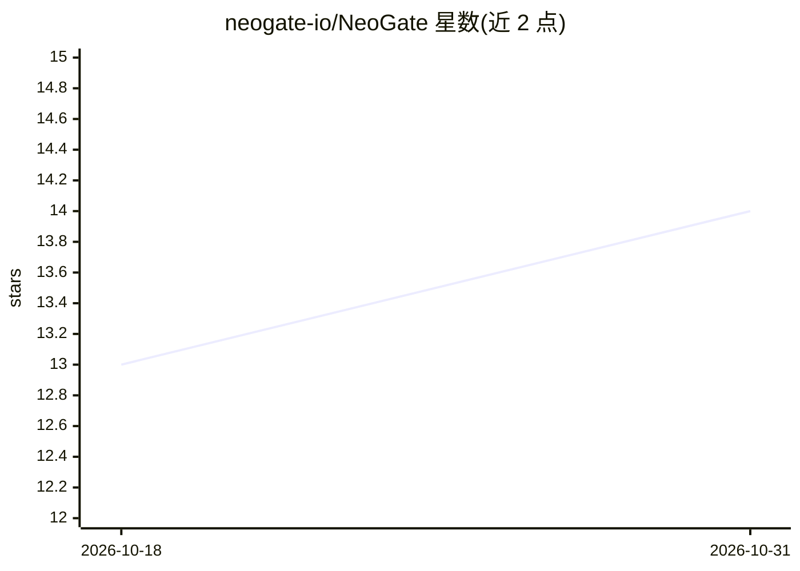

# neogate-io/NeoGate

⭐ 14 · Rust · AGPL-3.0 · 推送 2026-09-10 · [GitHub](https://github.com/neogate-io/NeoGate) · [官网](https://github.com/neogate-io/NeoGate) · 组织维护 · 中文 README

**企业私有化部署的 Rust LLM API 网关：统一入口、路由与计费**

用 Rust 构建的自托管大模型 API 网关，面向企业私有化部署：兼容 OpenAI 与 Anthropic 接口，集中托管上游凭证，提供项目化管理、多租户 API Key、按请求特征（多模态/工具调用/推理强度）的智能模型路由、上游故障切换、语音转写与视频生成接口、用量追踪与三级额度计费。支持企业微信/飞书/钉钉/Webhook/网页组件应用接入。部署以 Docker Compose 为主（单机含 PostgreSQL），源码运行需 Rust 1.94+、Node.js 20+、pnpm 与 PostgreSQL 16；生产多副本需外部 PostgreSQL 与 Redis。社区版 AGPL-3.0，另提供分层商业授权。

## 筛选速览

| 维度 | 判定 | 备注 |
|---|---|---|
| AI 角色 | `ai-ecosystem` | LLM/agent 周边工具 |
| 许可风险 | `dual` | AGPL-3.0 |
| 部署形态 | `self-host` | docker 或自建部署 |
| 模型依赖 | — | README 未给出锁定关系 |
| 硬件要求 | — | 无带数字的原话,不猜 |
| 安装摩擦 | `low` | 无编译、无系统依赖或容器化 |
| 成熟度 | — | 结构信号不足 |

## 能力要点

- 兼容 OpenAI 与 Anthropic 客户端接口，统一企业大模型入口
- 按请求特征的智能模型路由与上游异常自动冷却切换
- 多租户 API Key、三级额度、充值支付与可追踪账本
- 单机 Compose 到多副本集群的部署路径

## 适用场景

- 企业把各部门与内部应用的大模型调用统一纳管、核算成本
- 为外部客户或开发者提供带额度与计费的大模型调用服务
- 通过企业微信/飞书/钉钉向员工开放大模型对话入口

## 场景标签

`模型网关` · 领域:Agent 开发

## 证据(README 行号)

> L26: NeoGate 是一个使用 Rust 构建的大模型 API 网关，面向企业私有化部署场景，强调极致性能、简单易用和可控运维。它帮助企业把大模型调用统一到可管理、可观测、可计费的网关之下。
> L47:  提供企业自己的大模型 API 入口，兼容 OpenAI 和 Anthropic 接口，并集中托管上游凭证和访问策略。
> L58:  🧠 智能模型路由

## 星数曲线

2026-10-18 13 → 2026-10-31 14（+1）

---
*卡片 v1 · prompt 1.4 · 生成 2026-10-31 · 置信度 mid · 依据 README sha `f78545b8f20d` · [字段定义](../../DATASET.md)*
