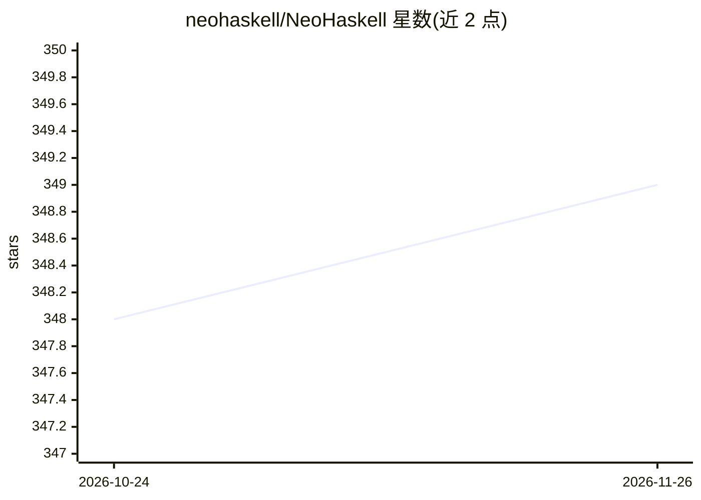

# neohaskell/NeoHaskell

⭐ 349 · Haskell · Apache-2.0 · 推送 2026-11-25 · [GitHub](https://github.com/neohaskell/NeoHaskell) · [官网](https://neohaskell.org) · 组织维护

**面向新手的 Haskell 方言与应用框架，简化应用开发**

NeoHaskell 是 Haskell 的方言及应用框架，保留 Haskell 类型安全，同时提供更清晰、显式的 API 与约定，降低上手门槛。项目为事件溯源应用提供基础——状态由事件历史推导而来，并整合语言、可复用库、集成与开发者工具，帮助构建与运行可靠应用。README 声明项目仍处于活跃开发中。主题标签包含 ai、并发、领域驱动设计、移动端与命令行等方向。

## 筛选速览

| 维度 | 判定 | 备注 |
|---|---|---|
| AI 角色 | `ai-enhanced` | 去掉 AI 部分产品仍成立 |
| 许可风险 | `permissive` | Apache-2.0 |
| 部署形态 | `None` |  |
| 模型依赖 | — | README 未给出锁定关系 |
| 硬件要求 | — | 无带数字的原话,不猜 |
| 安装摩擦 | `low` | 无编译、无系统依赖或容器化 |
| 成熟度 | `idea` | |

## 能力要点

- Haskell 方言，兼顾类型安全与新手友好的 API 约定
- 为事件溯源应用提供基础（状态由事件历史推导）
- 整合语言、库、集成与开发者工具链

## 适用场景

- 用事件溯源方式构建应用
- 希望以更低门槛使用 Haskell 类型系统的开发者

## 场景标签

 · 领域:编程语言/开发框架

## 证据(README 行号)

> L4: NeoHaskell is a Haskell dialect and application framework focused on newcomer
> L8: The project provides foundations for event-sourced applications, where state is

## 星数曲线

2026-10-24 348 → 2026-11-26 349（+1）

---
*卡片 v1 · prompt 1.4 · 生成 2026-11-25 · 置信度 mid · 依据 README sha `7db5f72c7884` · [字段定义](../../DATASET.md)*
