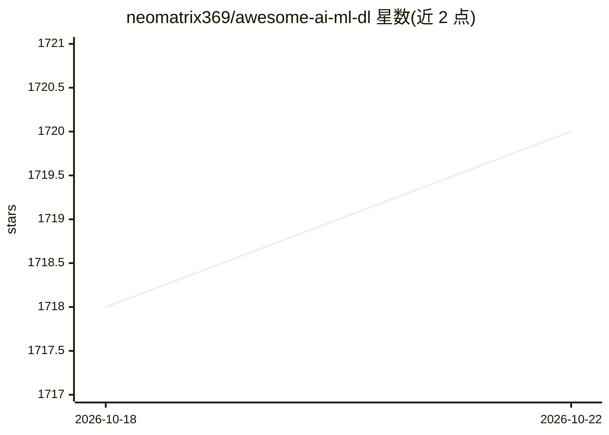

# neomatrix369/awesome-ai-ml-dl

⭐ 1,720 · Jupyter Notebook · NOASSERTION · 推送 2026-09-13 · [GitHub](https://github.com/neomatrix369/awesome-ai-ml-dl) · 个人维护

**AI/ML/DL 学习资源与学习笔记的策展清单**

面向工程师、开发者与数据科学家的 AI/ML/DL 知识聚合仓库：按领域（AI Agents、NLP、CV、LLM、生成式 AI、MLOps 等）、编程语言（Python、Java/JVM、Julia、Go、R 等）以及学习资源（课程、指南、论文、笔记本、速查表）组织 curated 链接，并附学习笔记。条目为外部第三方资源的索引与引用，仓库声明内容准确性不保证、使用需自行核验。采用 CC BY-SA 4.0 许可，社区驱动贡献。

## 筛选速览

| 维度 | 判定 | 备注 |
|---|---|---|
| AI 角色 | `ai-knowledge` | 知识聚合/清单类 |
| 许可风险 | `none` | NOASSERTION |
| 部署形态 | `None` |  |
| 模型依赖 | — | README 未给出锁定关系 |
| 硬件要求 | — | 无带数字的原话,不猜 |
| 安装摩擦 | `medium` | 含编译或系统依赖之一 |
| 成熟度 | — | 结构信号不足 |

## 能力要点

- 按领域与编程语言双维度组织 AI/ML/DL 资源链接
- 收录课程、竞赛、论文、笔记本、速查表等学习材料
- 含 Java/JVM 系（DL4J、Tribuo、DeepNetts 等）与其他语言生态条目
- 社区驱动贡献，CC BY-SA 4.0 许可

## 适用场景

- 系统查找 AI/ML/DL 各主题的学习资料与工具
- 按编程语言定位对应的机器学习库与项目
- 跟进课程、竞赛与研究论文等学习资源

## 场景标签

`精选清单` · 领域:学习与行业

## 证据(README 行号)

> L36: Awesome Artificial Intelligence, Machine Learning and Deep Learning as we learn it. Study notes and a curated list 
> L38: **This repo is dedicated to engineers, developers, data scientists and all other professions that take interest in 

## 星数曲线

2026-10-18 1,718 → 2026-10-22 1,720（+2）

---
*卡片 v1 · prompt 1.4 · 生成 2026-10-21 · 置信度 high · 依据 README sha `0ea219c91ed9` · [字段定义](../../DATASET.md)*
