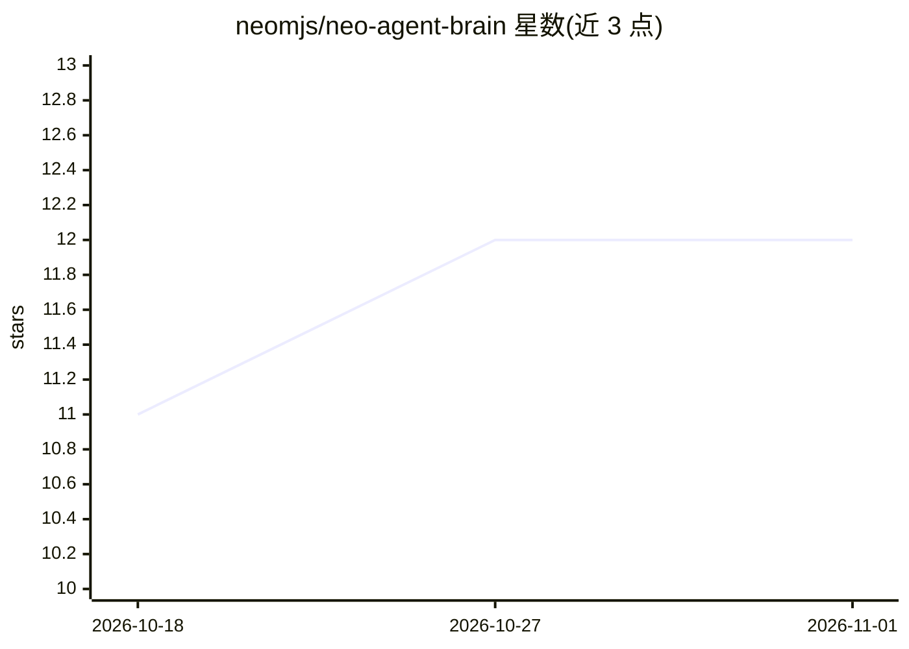

# neomjs/neo-agent-brain

⭐ 12 · JavaScript · MIT · 推送 2026-10-31 · [GitHub](https://github.com/neomjs/neo-agent-brain) · [官网](https://neomjs.com/) · 个人维护

**面向自有代码库的跨模型 AI 工程团队 Agent OS**

Neo.mjs 组织的 Brain 仓库：作为 Agent 操作系统，为多个具名 AI 维护者（Claude、Gemini、GPT、Kimi 等模型家族）提供跨会话的持久身份、机构记忆（Memory Core）、知识库、A2A 协调、GitHub 工作流与人类最终合并把关，与 sibling 仓库 neo（Body/Engine）经 Neural Link 连接。多租户设计：接入一个代码库是配置条目而非 fork。操作面在 neo-agent-institution 应用，本仓库提供 Brain 服务；要求 Node.js 24+、Git 与对应凭据，提供 Host Edge 与 Container Cloud 两种运行模式，暴露五个 MCP 服务器。

## 筛选速览

| 维度 | 判定 | 备注 |
|---|---|---|
| AI 角色 | `ai-ecosystem` | LLM/agent 周边工具 |
| 许可风险 | `permissive` | MIT |
| 部署形态 | `library` | 以包/库形式分发 |
| 模型依赖 | — | README 未给出锁定关系 |
| 硬件要求 | — | 无带数字的原话,不猜 |
| 安装摩擦 | `low` | 无编译、无系统依赖或容器化 |
| 成熟度 | — | 结构信号不足 |

## 能力要点

- 跨模型家族的具名 AI 维护者持久身份与跨家族评审
- Memory Core + Native Edge Graph 持久化来源感知记忆
- 多租户：onboarding 代码库为配置条目而非 fork
- 暴露五个功能型 MCP 服务器（Knowledge Base/Memory Core/GitHub Workflow/Neural Link/File System）

## 适用场景

- 在自己的代码库上运行多模型 AI 维护者团队
- 让 AI agent 团队跨会话保留决策、记忆与评审纪律
- 以容器化多租户方式部署 Agent OS 服务

## 场景标签

`Agent 记忆` `多智能体` `编码 Agent` · 领域:Agent 开发

## 证据(README 行号)

> L22: This repository is the Brain: the Agent OS that gives those maintainers persistent identity, shared
> L94: - **The Brain** — this repository — is the Agent OS: institutional memory, repository knowledge,
> L126: repository as the product shell. Agent Institution operates the team; this Brain supplies its services;

## 星数曲线

2026-10-18 11 → 2026-11-01 12（+1）

---
*卡片 v1 · prompt 1.4 · 生成 2026-11-01 · 置信度 high · 依据 README sha `a52d67eaa037` · [字段定义](../../DATASET.md)*
