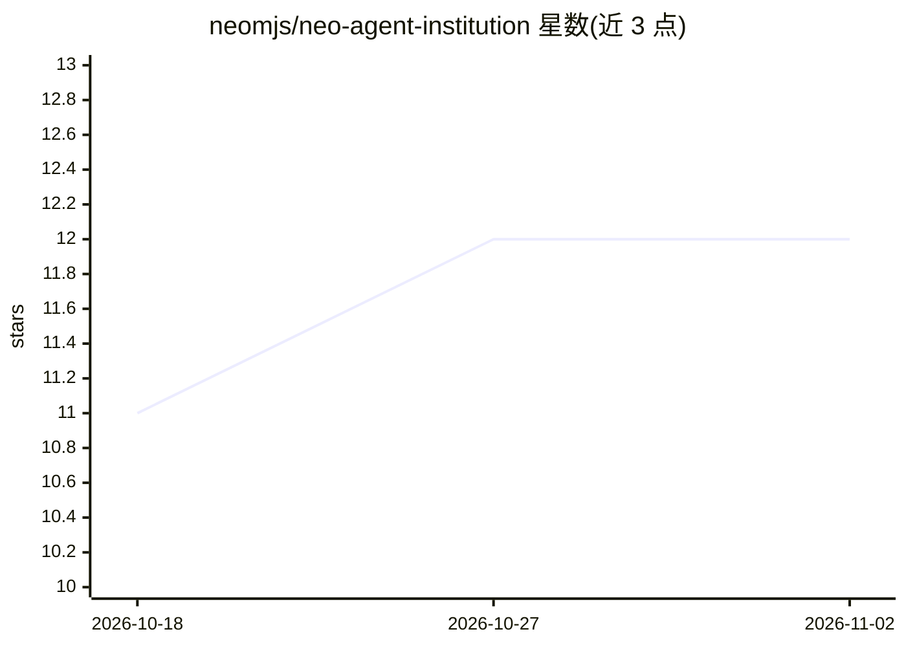

# neomjs/neo-agent-institution

⭐ 12 · JavaScript · MIT · 推送 2026-11-01 · [GitHub](https://github.com/neomjs/neo-agent-institution) · [官网](https://neomjs.com/) · 组织维护

**AI agent 团队的运营驾驶舱：查看与管控 agent 舰队**

Neo.mjs 组织的 Agent Institution 是面向操作员（operator）的 Web 应用，用于运营一支常设 AI agent 团队：展示成员名单、健康与生命周期状态、活动流、任务、记忆、邮箱与唤醒状态，支持实例/租户切换与 Overview/Focus/Review 视角，可停靠与弹出面板。生命周期控制通过 Fleet transport 连接的 neo-agent-brain 执行，UI 本身不含 Brain 实现。浏览器运行需 Git 与 Node.js 24+，另有可选 Electron 外壳；实时状态与操作需配置可达的 Brain 部署。

## 筛选速览

| 维度 | 判定 | 备注 |
|---|---|---|
| AI 角色 | `ai-ecosystem` | LLM/agent 周边工具 |
| 许可风险 | `permissive` | MIT |
| 部署形态 | `library` | 以包/库形式分发 |
| 模型依赖 | — | README 未给出锁定关系 |
| 硬件要求 | — | 无带数字的原话,不猜 |
| 安装摩擦 | `low` | 无编译、无系统依赖或容器化 |
| 成熟度 | — | 结构信号不足 |

## 能力要点

- agent 舰队名单与健康、生命周期、唤醒状态展示
- 记忆、邮箱、任务、活动流等操作界面
- 基于 Neo.mjs 引擎的可停靠/弹出多窗口面板
- 通过 Fleet transport 连接 Brain 服务执行生命周期控制

## 适用场景

- 运营者监控和管理多模型 AI agent 团队的工作与状态
- 为自有 agent 团队配置账号、凭据边界与实例切换
- 在浏览器或 Electron 外壳中查看 agent 记忆与消息

## 场景标签

`LLM 可观测性` · 领域:评测与运维

## 证据(README 行号)

> L28: The **Institution** makes that team operable. Agent Institution is the application where an operator
> L61: Lifecycle controls act through the connected Brain/Fleet service; the UI does not import or copy

## 星数曲线

2026-10-18 11 → 2026-11-02 12（+1）

---
*卡片 v1 · prompt 1.4 · 生成 2026-11-01 · 置信度 high · 依据 README sha `62b21ba80961` · [字段定义](../../DATASET.md)*
