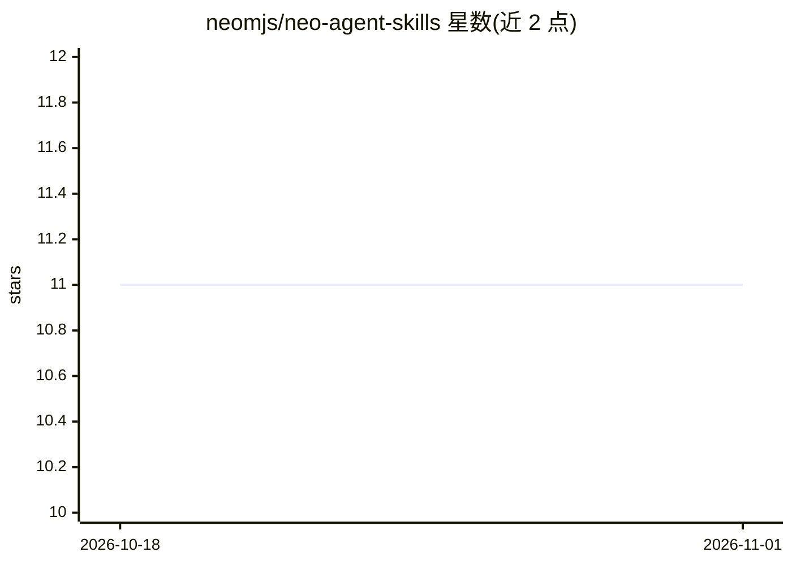

# neomjs/neo-agent-skills

⭐ 11 · JavaScript · MIT · 推送 2026-10-31 · [GitHub](https://github.com/neomjs/neo-agent-skills) · [官网](https://neomjs.com/) · 组织维护

**Neo.mjs 组织的 agent 技能底座包：技能物化、守卫与 CI 检查**

面向 neomjs 组织及其消费仓库的 npm 包，以依赖形式（而非拷贝）分发 agent 技能：postinstall 物化器将技能以符号链接投射到 .agents/skills 与 .claude/skills 两个面，供 Codex、Antigravity、Claude 等工具发现。附带多个 CI 守卫：符号链接正确性检查、源码注释工单引用扫描、23,800 字节的每回合指令预算检查、npm overrides 失效规则判定、凭据扫描与 agent PR 审查策略，另提供按受众生成 AGENTS.md 的工具。消费仓库通过 reusable workflow 在固定发布标签上调用这些检查。

## 筛选速览

| 维度 | 判定 | 备注 |
|---|---|---|
| AI 角色 | `ai-ecosystem` | LLM/agent 周边工具 |
| 许可风险 | `permissive` | MIT |
| 部署形态 | `library` | 以包/库形式分发 |
| 模型依赖 | — | README 未给出锁定关系 |
| 硬件要求 | — | 无带数字的原话,不猜 |
| 安装摩擦 | `low` | 无编译、无系统依赖或容器化 |
| 成熟度 | — | 结构信号不足 |

## 能力要点

- postinstall 物化器将技能以符号链接投射到 harness 中立面与 Claude 面
- 五类 CI 守卫：物化检查、注释考古、字节预算、npm overrides、凭据扫描
- 按 audience（maintainer/app 等）投影技能子集并生成 AGENTS.md

## 适用场景

- 多仓库组织以依赖形式统一分发和更新 agent 技能
- 在 CI 中校验技能符号链接与每回合指令字节数
- 拦截 agent 提交的不合规 PR 审查正文

## 场景标签

`Agent 框架` · 领域:Agent 开发

## 证据(README 行号)

> L3: The canonical agent skill substrate for the `neomjs` organization. Consuming repositories **depend
> L25: |`.agents/skills`|**one directory symlink** at the whole tree|harness-neutral discovery — Codex, Antigravity, any f

## 星数曲线

2026-10-18 11 → 2026-11-01 11（+0）

---
*卡片 v1 · prompt 1.4 · 生成 2026-11-01 · 置信度 high · 依据 README sha `d3ecc26663f8` · [字段定义](../../DATASET.md)*
